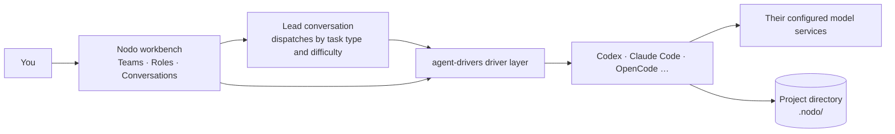

# Nodo

[简体中文](README.md) | English

**Bring Codex, Claude Code and other Agents together as a team, with roles and collaboration in one workbench.**

Nodo is a plugin for DeepSeek Harness (dsh). Each Agent keeps its own login, models, and tools; you manage roles, delegation, and conversations in one window instead of copying results between terminals.

## What you can do with Nodo

- **Use multiple Agents together**: access different Agents in one interface, each using its existing login and model configuration.
- **Assign roles**: write a role summary and instructions, and the Agent works to them inside its own CLI.
- **Teams**: a role can join several teams. Each team can have one 主控 (lead) and keeps its own task types.
- **Task assignment**: per team, name the role that takes each task type, optionally with its own model and thinking level; hard tasks can go to a different role.
- **Lead delegation**: the lead dispatches by task type and difficulty and receives the executor's report. Delegations and reports show round by round, with 查看会话 opening the executor conversation.
- **Projects and conversations**: organize role conversations by project, create Git worktrees when changes need isolation, and keep archived conversations readable after a role or project is deleted.
- **Project tools**: the right sidebar browses project files, shows the turn's file changes, opens terminals in the project directory, and embeds a browser for local pages.
- **Allocate cost by task**: hard work goes to the stronger Agent, routine work to a cheaper role and model.

## Installation

### Prerequisites

- dsh 0.2.0-rc.1 or later.
- At least one Agent with login or model configuration completed. Current integrations include Codex, Claude Code, DeepSeek Harness, ZCode, CodeBuddy, OpenCode, Qoder, and Pi (experimental). Available features depend on the Agent version and its public interfaces.
- Node.js 24 or later when installing from source.

### Install the plugin

On the dsh plugin page, select **Add plugin** → **Install third-party plugin**, then enter one of these sources:

- Package name: `dsh-plugin-nodo`
- GitHub repository: `https://github.com/waikoeng234/Nodo`
- Local directory: the path to `orchestrator/` on your machine; see “Install from source” below.

Reload the plugin. Installation is complete when **Nodo** appears in the sidebar.

### Install from source

1. Clone this repository and run:

   ```sh
   cd orchestrator
   npm ci --ignore-scripts
   npm run build:check
   ```

2. Enter the local path to `orchestrator/` on the plugin page.

To update, pull the latest code, rerun the commands above, and reload the plugin.

## Quick start

1. **Complete onboarding**: open Nodo, enable Agents, create a general-purpose role, then add a project to start chatting. For any Agent that is not detected automatically, enter its executable path in 设置 → 模型提供方与 Agent (Settings → Model providers and Agents).
2. **Add more projects**: keep adding local working directories in the sidebar's project area. To work in isolation, choose 创建工作树… (create a worktree) from a project's row menu.
3. **Create roles**: on the 角色 (roles) page, create a role with a name, role summary, and instructions, then choose its Agent, model, thinking level, and permission. Preset templates such as `researcher`, `coder`, `tester`, `reviewer`, and `writer` can fill these in, or write your own. A role's Agent cannot be changed after creation.
4. **Create a team and set its lead**: in 团队 (teams) on the same page, add a team, drag executor roles into the member column, and drag the role that should lead into 拖入主控 (drop a lead here). Only Claude Code and Codex can lead. A lead leads one team and is never a member of any team. A session acting as lead cannot use 仅可查看 (view-only, plan mode).
5. **Assign tasks**: click 任务分配 (task assignment), add a task type with a name and a “when to dispatch this type” note, and choose the role that takes it. Turn on 困难任务单独指定 (assign hard tasks separately) when hard work should go to another role.
6. **Start delegating**: in the sidebar's 团队 tab, start a conversation with the lead and state the goal and constraints. The lead dispatches according to the team's assignment and receives the results; a round shows its delegations and their reports together, and 查看会话 opens the executor conversation.

## Why choose Nodo

Model performance depends on both the model itself and the **Harness** running it.

- **Multiple model APIs**: switch models while the same Harness executes the work.
- **Subagents**: split tasks while collaboration remains inside one Harness.
- **Nodo**: coordinate multiple native Agents, each executing inside its own Harness.

| Key difference | Nodo | Multiple model APIs / Subagents in one Harness |
| --- | --- | --- |
| Integration level | Coordinates multiple native Agents | Uses multiple models or subagents inside one Harness |
| Execution | Each Agent retains its supported native execution environment | Uses the current Harness's execution framework throughout |
| Cross-vendor capabilities | Combines native Agents from different vendors | Combines models; connecting an API does not automatically bring the native Agent's capabilities |
| Task collaboration | Splits work across Agents, with lead delegation and report handoff | Relies primarily on the current Harness's routing and delegation capabilities |
| Control | Manages multi-Agent conversations and delegation in one window | Manages models or subagents within a single Agent environment |

Nodo also works alongside Subagents: Agents in Nodo can still run their own [Subagents](https://code.claude.com/docs/en/sub-agents).

## How it works

Consider a “plan → implement → review” collaboration: the lead `leader` plans and delegates with Claude Code, `coder` implements with Codex, and `reviewer` reviews with OpenCode.



Codex, Claude Code, Qoder, Pi, ZCode, OpenCode and CodeBuddy connect through their own drivers and display conversations in the Nodo Feed. DSH roles use the dsh native conversation view.

### Integration: Agents do the work

Nodo connects through each Agent's official public interfaces, such as Codex app-server, Claude Code stream-JSON, and OpenCode ACP. The Agent itself writes the code, using its own login, model, tools, and context management. Nodo starts sessions, forwards messages and approvals, and presents the results in one interface.

### Roles: how an Agent receives its identity

The role summary and instructions you define for a role are injected through the Agent's own system-prompt channel, such as Claude Code's `--append-system-prompt` or Codex developer instructions. A few Agents receive them through identity files or MCP tools. They are injected once per conversation and kept out of your chat messages. The saved 身份 records which template filled them; it is used for display and template matching only and is never injected.

In this example, Codex follows the `coder` responsibilities from the first message, while OpenCode reviews as `reviewer`.

### Teams and leads: how work is delegated

- **Who leads**: drag a role into a team's lead column to make it that team's 主控. A role can be a member of several teams, but leads only one team. The lead dispatches through tools that Nodo provides, and may only use its own team's task types and difficulties.
- **Where it delegates**: only a lead conversation started in the sidebar's 团队 tab delegates. A lead conversation started in the 角色 tab is an ordinary 1:1 chat that never delegates and may use plan mode.
- **Who takes the task**: each task type in the team's assignment names its role. When a type also names a hard-task role, hard work goes there and the rest to the normal role; without it, the normal role takes every task. With no role assigned, the lead stops and reports the gap.
- **One at a time**: a lead conversation runs one delegation at a time. The report returns to the lead before the next delegation starts.
- **Reuse and restart**: follow-up work is routed by the team's current assignment. A change of difficulty or executor starts a new session that carries the existing changes and remaining questions; one executor session can be reused at most twice.
- **When things go wrong**: long silence only marks a turn as suspected stuck, never a failure. If a stop remains unconfirmed after 15 seconds, Nodo settles it as an unconfirmed interruption and frees the delegation slot. Delegated tasks that hit a transient error classified by Codex, Claude Code, Qoder or OpenCode continue automatically in the same session, up to 5 times at 30-second intervals; stopping the executor, a lead interrupt or a message in that executor conversation cancels continuation.

### References: passing results between conversations

Agents do not share conversation context. To let role B refer to role A's results, use the 引用会话 (reference conversation) feature in role B's conversation, select a completed reply from role A, and send it with your message. It is marked as reference material, not instructions, so it does not change the current role's identity or permissions.

In the example, you can reference `leader`'s plan in the `coder` conversation, then reference `coder`'s implementation in the `reviewer` conversation, moving the process forward manually.

> Why this design: it removes repeated copying and pasting when working with multiple Agents.

### Report handoff: how executor results reach the lead

When an executor conversation ends, its final reply is saved as a reference snapshot and the lead receives a report message carrying that reference; when a reference cannot be created, the reply is quoted inline instead. The report is marked as reference material, not instructions, and the lead is expected to check it against files and evidence.

The executor's intermediate steps never enter the lead's context. Use 查看会话 to read the original transcript, and the lead can consult its own delegation table when it needs the picture.

> Why this design: the lead's context keeps conclusions and references instead of growing with every step, and each output stays on disk for later review.

## Data and privacy

- **Plugin data**: projects, roles, teams, conversations, reference snapshots, and credentials are stored locally in `~/.dsh/orchestrator` (or the `orchestrator/` subdirectory of `DSH_HOME` when set). Do not upload this directory when reporting issues.
- **Files written to your project**: creating a Git worktree adds `.nodo/worktrees/` to the repository. Files and images sent to a lead are copied under the project's `.nodo/`, with their paths written into the message so the lead can pass them to an executor. Nodo writes a `.gitignore` inside `.nodo/`, keeping these files out of the project's Git changes.
- **Credentials**: saved in local files readable only by the current user, with access scoped by role.
- **Code and model services**: Nodo itself does not upload data, but each Agent sends tasks and code to its configured model service. Costs and data policies are governed by that service.

## Current limitations

- Models, thinking levels, images, attachments, input during running turns, and compaction differ across Agents. Nodo integrates only the capabilities each Agent actually provides.
- Whether conversations can also be viewed in an Agent's own application depends on its integration method.
- Leads currently must be Claude Code or Codex. Conversations on the dsh engine are not merged into rounds in the team view and stay as ordinary conversations.
- A lead can only delegate work configured as a task type with an assigned role in its team.
- The right sidebar's terminals require terminal support from the host. Nodo conversations opened in the native conversation view keep dsh's own right sidebar.
- The embedded browser opens HTTP(S) pages only. Outside the desktop app it uses an iframe, and some sites refuse to be framed; open those in an external browser.
- Tool details, file changes, and run status shown in the interface are for reference. Actual files and Agent state are authoritative.
- An integration does not mean every version and platform has been accepted. Host or CLI version changes may affect compatibility.

## FAQ

### Nodo does not appear after installation

Reload the plugin and page, reopen dsh if needed, and check the plugin page for duplicate Nodo installations.

For a local installation, also check that the path points to `orchestrator/`, the directory containing `package.json`, and that `npm ci --ignore-scripts` and `npm run build:check` have completed successfully there.

### An installed Agent is not detected

The host process may have a different `PATH` from your terminal. Enter the CLI's absolute path in Agent settings, save, and check again. Confirm that the path points to an executable file.

### The model list is empty, or the model service cannot be reached

First verify login and model configuration in the Agent's own environment. Then return to Nodo, save settings, check the connection again, and scan local configuration.

### Why does the lead not delegate?

Check in order: the team has a lead; executor roles have joined that team; the team has task types; each type names a role; hard tasks name a role when assigned separately. A lead can only dispatch its own team's task types, and it stops with an explanation when no role qualifies.

### Can I still read conversations after deleting a role or project?

Yes. Those conversations are archived on deletion. Transcripts, statistics, references, and tool details are retained, and the conversations open read-only from the 已移除 entry in the sidebar: you cannot send, compact, or unarchive them. Manually archived conversations also open read-only; unarchive one to keep working in it. A deleted role also leaves its teams, and a team it led loses its lead; its name can be reused.

### Why is the interface read-only?

Another dsh instance may be using the same data directory, or the state file may have failed to load. Follow the message shown in the interface. Do not delete lock files or overwrite state files directly.

## Contributing

Issue reports, documentation corrections, and code contributions are welcome. See the [contribution guide](CONTRIBUTING.en.md) for the process and issue-reporting requirements.

- Issue tracker: `https://github.com/waikoeng234/Nodo/issues`.

## Development

- [Development guide](docs/development.md): building, testing, adding Agents, and submitting PRs.
- [Architecture guide](docs/architecture.md): code structure, message paths, and data storage.
- [Design system](DESIGN.md): palette, typography, spacing, and component rules.

## License and third-party content

Nodo is licensed under [Apache-2.0](LICENSE). See [NOTICE](NOTICE) for copyright information and the [third-party notices](orchestrator/THIRD_PARTY_NOTICES.txt) for third-party content. Product names and trademarks mentioned belong to their respective owners.
