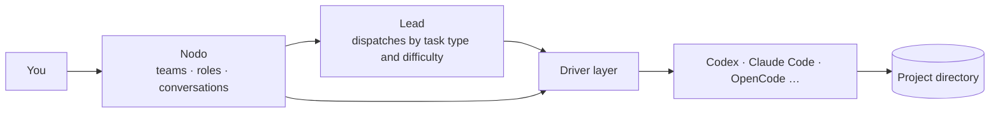

# Nodo

[简体中文](README.md) | English

**One person, directing a team of AI coding agents.**

Let Claude Code plan, Codex implement, and OpenCode review. You state the goal; they split the work, execute it, and report back.

## The problem

When you use several AI coding tools at once, you jump between terminals, copy results by hand, retell context, and keep track of who did what in your head.

Nodo is a plugin for DeepSeek Harness (dsh). It puts those Agents in **one window**:

- **Each keeps its own setup**: every Agent still uses its own login, models, and tools. Nodo connects through each Agent's public interfaces and does not do the work for it.
- **Someone dispatches**: set one **lead**. It assigns work to the right role by task type and difficulty, and the results return to the lead automatically, with no copying from you.
- **Save cost**: hard work goes to a stronger model, routine work to a cheaper role.

## Three steps

1. **Create roles**: give each Agent a name and a job, such as `coder` (Codex) and `reviewer` (OpenCode).
2. **Form a team**: put roles in a team, pick a lead (Claude Code or Codex), and set which task type goes to whom.
3. **State the goal**: start a conversation in the team and tell the lead what you want. It delegates, executors work, and reports come back, all shown round by round in one interface. Open 查看会话 (view conversation) at any time for details.

## Installation

**Requirements**: dsh 0.2.0-rc.1 or later; at least one Agent that is logged in. Current integrations: Codex, Claude Code, DeepSeek Harness, ZCode, CodeBuddy, OpenCode, Qoder, and Pi (experimental).

On the dsh plugin page, click **Add plugin** → **Install third-party plugin**, enter either source below, and reload. The plugin is installed when **Nodo** appears in the sidebar:

- Package name: `dsh-plugin-nodo`
- GitHub URL: `https://github.com/waikoeng234/Nodo`

To install from source, clone the repository, run `npm ci --ignore-scripts && npm run build:check` in `orchestrator/` (Node.js 24+), then enter that directory's path on the plugin page.

## Quick start

1. **First-run guide**: open Nodo and follow the prompts to enable an Agent, create a role, and add a project. For an Agent that is not detected, enter its program path in **Settings → Model providers and Agents**.
2. **Create a role**: in the 角色 (roles) page, add one, write a role summary, and choose the Agent, model, and permissions. Preset templates such as `coder`, `reviewer`, and `tester` are available.
3. **Create a team and set its lead**: add a team, drag executor roles into the member column, and drag the lead role into 拖入主控 (drop a lead here).
4. **Assign tasks**: click 任务分配 (task assignment), add a task type (for example, feature work), and choose the role that takes each type. Use 困难任务单独指定 (assign hard tasks separately) to give hard work to another role.
5. **Start delegating**: in the sidebar's 团队 (teams) tab, start a conversation, choose the lead, and state the goal.

> Only Claude Code or Codex can lead, and a lead leads one team. Only a lead conversation started under the 团队 tab dispatches work.

## Why not multi-model APIs or Subagents

They switch models or split tasks inside **one Harness**. Nodo organizes **several native Agents**, each keeping its own execution environment. The two do not conflict; Agents in Nodo can still use their own Subagents.

## How it works

- **Integration**: through each Agent's public interface (for example Codex app-server, Claude Code stream-JSON, OpenCode ACP).
- **Roles**: the role summary is injected through the Agent's own system-prompt channel, once per conversation.
- **Delegation**: the lead dispatches one task at a time and may dispatch the next only after the report returns.
- **Reports**: the lead receives only conclusions and references. Intermediate steps stay in the executor conversation; open 查看会话 to read them.

For more detail, see the [architecture guide](docs/architecture.md).

## Data and privacy

- Projects, roles, teams, and conversations are stored locally in `~/.dsh/orchestrator`. Do not upload this directory when reporting issues.
- Nodo itself uploads nothing, but each Agent sends tasks and code to the model service it is configured with. Costs and data rules follow that service.

## Current limitations

- Agents differ in models, thinking levels, images, attachments, and more. Nodo only integrates what an Agent actually provides.
- Only Claude Code and Codex can currently lead.
- If a task type has no assigned role, the lead cannot dispatch it; it states the gap and stops.
- ZCode cannot call its subscription service directly. Create an API key under your coding plan, add a custom provider in ZCode with that key, and ZCode models will then be detected.

## FAQ

**Nodo does not appear after installation?** Reload the plugin and page. For a local install, confirm the path points to the `orchestrator/` directory that contains `package.json`, and that `npm ci --ignore-scripts` and `npm run build:check` have been run.

**An Agent is not detected?** The host's `PATH` may differ from your terminal's. Enter the CLI's absolute path in the Agent settings.

**The lead does not delegate?** Check in order: the team has a lead, the executor roles are in the team, the team has task types, and each type has an assigned role.

**Can I still read conversations after deleting a role or project?** Yes. They are archived and can be read in the sidebar's 已移除 (removed) section.

## Build it together

I'm an independent author with limited time. If you're interested in Nodo and have the skills and energy to help develop it, leave a message in [Discussions](https://github.com/waikoeng234/Nodo/discussions) or [Issues](https://github.com/waikoeng234/Nodo/issues) with your ideas or the area you'd like to take on.

Integrating new Agents, improving docs, fixing bugs, and writing tests are all welcome.

## Contributing

Issues and pull requests are welcome: [Contributing guide](CONTRIBUTING.en.md) · [Development guide](docs/development.md) · [Architecture guide](docs/architecture.md) · [Design system](DESIGN.md) · [Issues](https://github.com/waikoeng234/Nodo/issues)

## License

[Apache-2.0](LICENSE). See [NOTICE](NOTICE) for copyright and [third-party notices](orchestrator/THIRD_PARTY_NOTICES.txt) for third-party content. Product names and trademarks mentioned belong to their respective owners.
