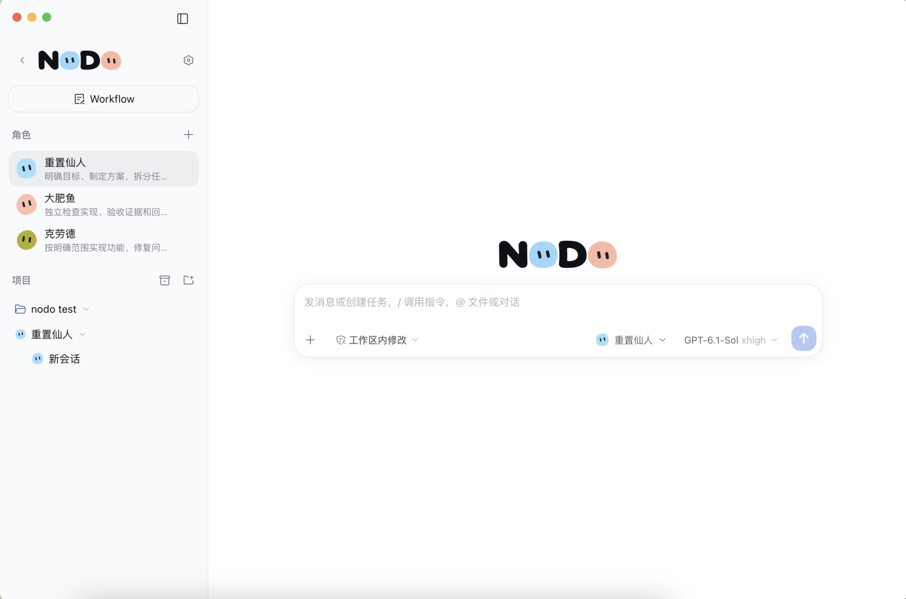
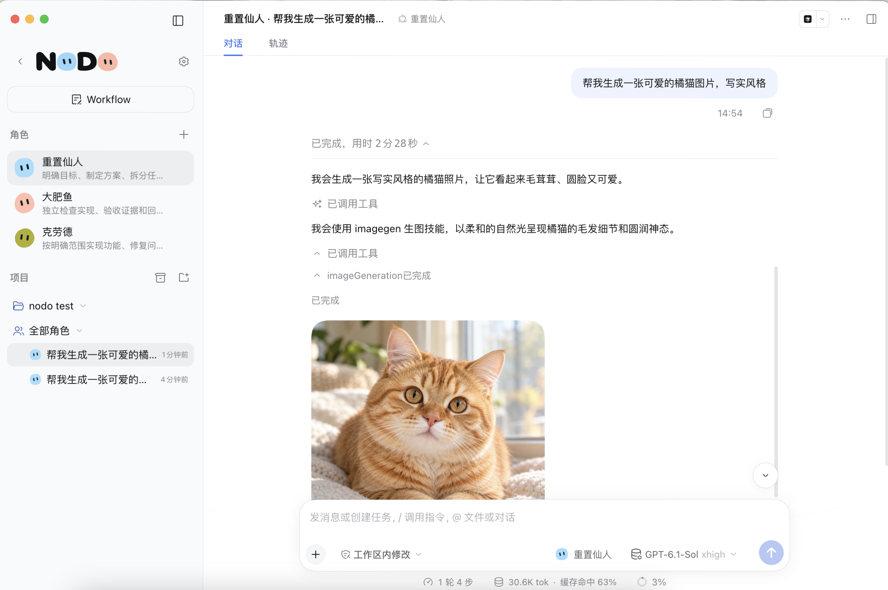
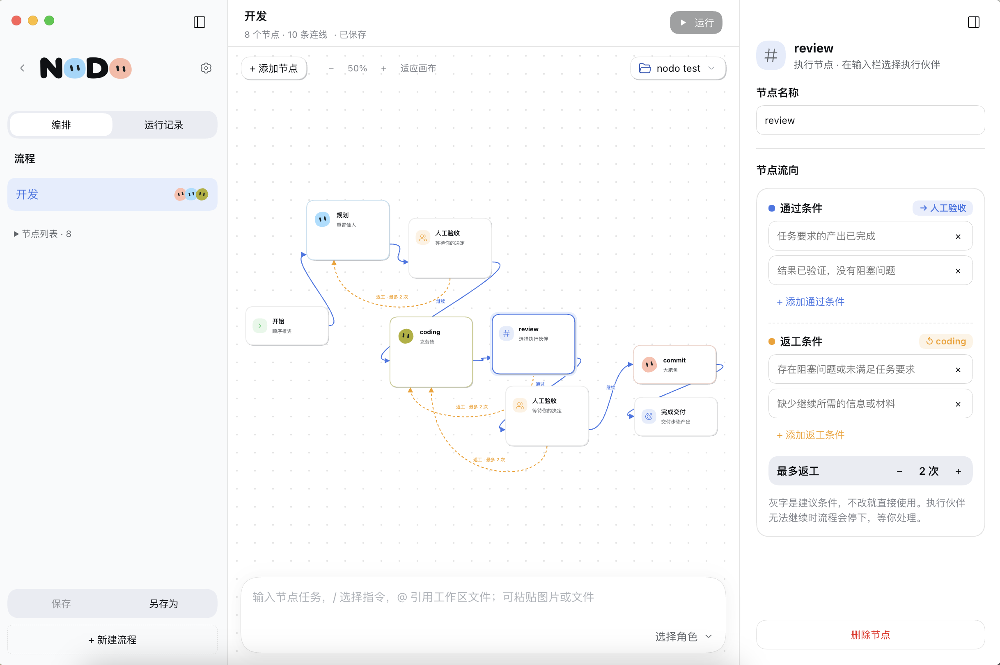
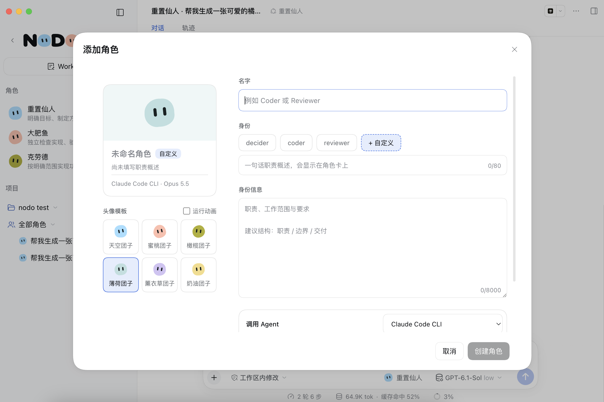
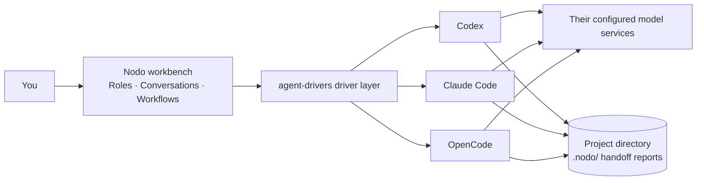

# Nodo

[简体中文](README.md) | English

**Bring Agents such as Claude Code and Codex together as a team, with roles and collaboration in one workbench.**

Nodo runs as a plugin in DeepSeek Harness (dsh).

## Preview

<p align="center">
  <a href="docs/Image/conversations.png"></a>
  <a href="docs/Image/streaming.png"></a>
  <a href="docs/Image/workflow.png"></a>
  <a href="docs/Image/role.png"></a>
</p>

## What you can do with Nodo

- **Use multiple Agents together**: access different Agents in one interface, each using its existing configuration and authentication.
- **Assign roles**: define each role's summary and instructions, then assign work by task type.
- **Delegate through a lead**: once at least one executor exists, optionally add a lead under 主控 on the roles page to assign tasks by type and difficulty in the current project and receive the reports; a lead is created with the `leader` identity. A lead session takes one row in the sidebar, and its page merges delegations and reports round by round — one message makes one round — with 查看会话 opening each executor session; sessions on the dsh engine are not merged and stay as ordinary conversations. Unclaimed task types go to the fallback role, initially the first executor; transfer it in the task acceptance settings.
- **Manage projects and conversations**: organize role conversations by project and revisit their history. Create Git worktrees when changes need isolation. Deleting a role or project archives its conversations, which stay readable from the 已移除 entry in the sidebar.
- **Build visual workflows**: arrange tasks and handoffs, with human checkpoints, conditional branches, and rework.
- **Allocate cost by task**: assign complex work to more capable Agents and routine tasks to less expensive Agents.

## Installation

### Prerequisites

- dsh 0.2.0-rc.1 or later.
- At least one Agent with login or model configuration completed. Current integrations include Codex, Claude Code, DeepSeek Harness, ZCode, CodeBuddy, OpenCode, Qoder, and Pi (experimental). Available features depend on the Agent version and its public interfaces.
- Node.js 24 or later when installing from source.

### Install the plugin

On the dsh plugin page, select **Add plugin** → **Install third-party plugin**, then enter one of these sources:

- Package name: `dsh-plugin-nodo`
- GitHub repository: `https://github.com/waikoeng234/Nodo`
- Local directory: the path to `orchestrator/` on your machine; see “Install from source” below.

Reload the plugin. Installation is complete when **Nodo** appears in the sidebar.

### Install from source

1. Clone this repository and run:

   ```sh
   cd orchestrator
   npm ci --ignore-scripts
   npm run build:check
   ```

2. Enter the local path to `orchestrator/` on the plugin page.

To update, pull the latest code, rerun the commands above, and reload the plugin.

## Quick start

1. **Complete onboarding**: open Nodo, enable Agents, create a general-purpose role, then add a project to start chatting. For any Agent that is not detected automatically, enter its executable path in **Settings → Model providers and Agents**.
2. **Add more projects**: keep adding local working directories from the sidebar's project list.
3. **Add roles as needed**: to delegate work, add a lead on the roles page (requires at least one executor); it is created with the `leader` identity. An executor can use a preset identity such as `researcher`, `coder`, `tester`, `reviewer`, or `writer`, or fill in its own identity, role summary, and instructions. Choose its Agent and default model. A role's Agent cannot be changed after creation.
4. **Run a workflow**: create a flow under **Workflow** in the sidebar. Assign roles and tasks to execution nodes, and add human checkpoints as needed. After starting the workflow, inspect each step's status and report in the run records.

## Why choose Nodo

Model performance depends on both the model itself and the **Harness** running it.

- **Multiple model APIs**: switch models while the same Harness executes the work.
- **Subagents**: split tasks while collaboration remains inside one Harness.
- **Nodo**: coordinate multiple native Agents, each executing inside its own Harness.

| Key difference | Nodo | Multiple model APIs / Subagents in one Harness |
| --- | --- | --- |
| Integration level | Coordinates multiple native Agents | Uses multiple models or subagents inside one Harness |
| Execution | Each Agent retains its supported native execution environment | Uses the current Harness's execution framework throughout |
| Cross-vendor capabilities | Combines native Agents from different vendors | Combines models; connecting an API does not automatically bring the native Agent's capabilities |
| Task collaboration | Assigns work, hands off results, and coordinates workflows across Agents | Relies primarily on the current Harness's routing and delegation capabilities |
| Control | Manages multi-Agent conversations and cross-Agent flows in one window | Manages models or subagents within a single Agent environment |

Nodo also works alongside Subagents: Agents in Nodo can still run their own [Subagents](https://code.claude.com/docs/en/sub-agents).

## How it works

Consider a “plan → implement → review” workflow: `leader` plans with Codex, `coder` implements with Claude Code, and `reviewer` reviews with OpenCode.



Codex, Claude Code, Qoder, Pi, ZCode, OpenCode and CodeBuddy connect through their own drivers and display conversations in the Nodo Feed. DSH roles use the dsh native conversation view.

### Integration: Agents do the work

Nodo connects through each Agent's official public interfaces, such as Codex app-server, Claude Code stream-JSON, and OpenCode ACP. Claude Code itself writes the code, using its own login, model, tools, and context management. Nodo starts sessions, forwards messages and approvals, and presents the results in one interface.

### Roles: how an Agent receives its identity

The role summary and instructions you define for a role are injected through the Agent's own system-prompt channel, such as Claude Code's `--append-system-prompt` or Codex developer instructions. A few Agents receive them through identity files or MCP tools. They are injected once per conversation and kept out of your chat messages. The 身份 label shown on the roles page is an interface label for telling roles apart and applying templates; it is never injected.

In this example, Claude Code follows the `coder` responsibilities from the first message, while OpenCode reviews as `reviewer`.

### References: passing results between conversations

Agents do not share conversation context. To let role B refer to role A's results, use the `/引用会话` (reference conversation) feature in role B's conversation, select a completed reply from role A, and send it with your message. It is marked as “reference material, not instructions” when sent to the Agent, so it does not change the current role's identity or permissions. This is also the basis for Agent handoffs in workflows.

In the example, you can reference `leader`'s plan in the `coder` conversation, then reference `coder`'s implementation in the `reviewer` conversation, moving the process forward manually.

> Why this design: it removes repeated copying and pasting when working with multiple Agents.

### Handoffs: passing results through a workflow

In a workflow, each step's final reply is saved as a report under the project's `.nodo/workflow-runs/`. The next step receives only the latest report's path and an index, and reads them as needed. Reports are also marked as “reference material, not instructions.” A choice you make at a human checkpoint is passed to the next step as an instruction.

In the example, `reviewer` reads the implementation report. If the review requests rework, `coder` can read the review feedback before trying again.

> Why this design: context does not keep growing with every step; each step's output stays on disk for later review; and it reduces the risk of one Agent's output being executed as instructions by the next.

## Data and privacy

- **Plugin data**: projects, roles, conversations, and workflow records are stored locally in `~/.dsh/orchestrator` (or the `orchestrator/` subdirectory of `DSH_HOME` when set). Do not upload this directory when reporting issues.
- **Files written to your project**: when running workflows, Nodo creates a `.nodo/` directory in the project for step reports and attachment copies. It automatically writes a `.gitignore` inside, keeping these files out of the project's Git changes.
- **Credentials**: saved in local files readable only by the current user, with access scoped by role.
- **Code and model services**: Nodo itself does not upload data, but each Agent sends tasks and code to its configured model service. Costs and data policies are governed by that service.

## Current limitations

- Models, thinking levels, images, attachments, input during running turns, and compaction differ across Agents. Nodo integrates only the capabilities each Agent actually provides.
- Whether conversations can also be viewed in an Agent's own application depends on its integration method.
- Workflows currently support sequential steps, branches, and bounded rework. Parallel execution is not supported.
- Tool details, file changes, and run status shown in the interface are for reference. Actual files and Agent state are authoritative.
- An integration does not mean every version and platform has been accepted. Host or CLI version changes may affect compatibility.

## FAQ

### Nodo does not appear after installation

Reload the plugin and page, reopen dsh if needed, and check the plugin page for duplicate Nodo installations.

For a local installation, also check that the path points to `orchestrator/`, the directory containing `package.json`, and that `npm ci --ignore-scripts` and `npm run build:check` have completed successfully there.

### An installed Agent is not detected

The host process may have a different `PATH` from your terminal. Enter the CLI's absolute path in Agent settings, save, and check again. Confirm that the path points to an executable file.

### The model list is empty, or the model service cannot be reached

First verify login and model configuration in the Agent's own environment. Then return to Nodo, save settings, check the connection again, and scan local configuration.

### Why has a workflow stopped at a step?

Inspect the stop reason in the run details. Review the corresponding conversation and actual files, then choose to retry, accept the output, or cancel.

### Can I still read conversations after deleting a role or project?

Yes. Those conversations are archived on deletion. Transcripts, statistics, references, and tool details are retained, and the conversations open read-only from the 已移除 entry in the sidebar: you cannot send, compact, or unarchive them. Manually archived conversations also open read-only; unarchive one to keep working in it. A deleted role also leaves the lead's roster and workflow node choices, and its name can be reused.

### Why is the interface read-only?

Another dsh instance may be using the same data directory, or the state file may have failed to load. Follow the message shown in the interface. Do not delete lock files or overwrite state files directly.

## Contributing

Issue reports, documentation corrections, and code contributions are welcome. See the [contribution guide](CONTRIBUTING.en.md) for the process and issue-reporting requirements.

- Issue tracker: `https://github.com/waikoeng234/Nodo/issues`.

## Development

- [Development guide](docs/development.md): building, testing, adding Agents, and submitting PRs.
- [Architecture guide](docs/architecture.md): code structure, message paths, and data storage.

## License and third-party content

Nodo is licensed under [Apache-2.0](LICENSE). See [NOTICE](NOTICE) for copyright information and the [third-party notices](orchestrator/THIRD_PARTY_NOTICES.txt) for third-party content. Product names and trademarks mentioned belong to their respective owners.
