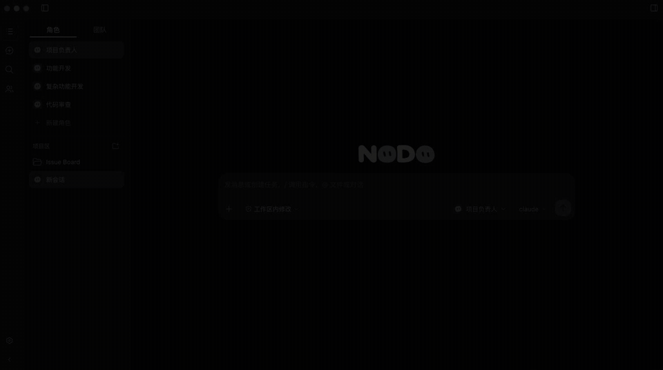
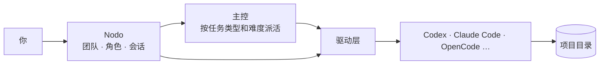

# Nodo

简体中文 | [English](README.en.md)

**一个人，指挥一支 AI 编程团队。**

让 Claude Code 规划、Codex 实现、OpenCode 审查——你只说目标，剩下的由它们自己分工、执行、汇报。

## 它解决什么问题

同时用好几个 AI 编程工具时，你要在多个终端之间来回切换，手动复制结果、转述上下文，谁做到哪一步全靠记忆。

Nodo 是运行在 DeepSeek Harness（下称 dsh）里的插件，把这些 Agent 放进**同一个窗口**：

- **各用各的**：每个 Agent 仍用自己原生的登录、模型和工具，Nodo 只通过官方公开接口接入，不替它们干活。
- **有人派活**：设一名**主控**，由它按任务类型和难度把活派给合适的角色，执行结果自动回到主控，不用你搬运。
- **省钱**：难题交给强模型，常规任务交给便宜的角色。

## 三步看懂

1. **建角色**：给每个 Agent 定名字和职责，例如 `coder`（Codex）、`reviewer`（OpenCode）。
2. **组团队**：把角色放进团队，指定一名主控（Claude Code 或 Codex），并设置「什么任务派给谁」。
3. **说目标**：在团队里新建会话，告诉主控你要什么。它派活、执行者干活、报告回来，整个过程在一个界面里按轮显示，随时点「查看会话」看细节。

## 安装

**需要**：dsh 0.2.0-rc.1 或更高版本；至少一个已登录的 Agent（目前已接入 Codex、Claude Code、DeepSeek Harness、ZCode、CodeBuddy、OpenCode、Qoder，Pi 为实验性接入）。

在 dsh 插件页点击 **添加插件** → **安装第三方插件**，输入下面任一来源，重新加载后侧栏出现 **Nodo** 即成功：

- 包名：`dsh-plugin-nodo`
- GitHub 地址：`https://github.com/waikoeng234/Nodo`

从源码安装：克隆仓库后在 `orchestrator/` 执行 `npm ci --ignore-scripts && npm run build:check`（需要 Node.js 24+），再在插件页填入该目录路径。

## 快速开始

1. **首次引导**：打开 Nodo，按提示启用 Agent、创建角色、添加项目。检测不到的 Agent，到 **设置 → 模型提供方与 Agent** 填程序路径。
2. **创建角色**：在「角色」页新建，填职责概述，选 Agent、模型和权限。可套用 `coder`、`reviewer`、`tester` 等预置模板。
3. **建团队、设主控**：新增团队，把执行角色拖进成员区，把主控角色拖进「拖入主控」。
4. **任务分配**：点「任务分配」，添加任务类型（如「功能开发」），为每种类型指定承接角色；需要时用「困难任务单独指定」为难题另选角色。
5. **开始派活**：在左侧「团队」标签下新建会话，选择主控，说明目标。

> 主控只能是 Claude Code 或 Codex，且只领导一个团队。只有在「团队」标签下新建的主控会话才会派活。

## 为什么不直接用「多模型 API」或 Subagent

它们是在**同一个 Harness** 里换模型或拆任务；Nodo 是把**多个原生 Agent** 组织起来，各自保留自己的执行环境。两者不冲突，Agent 在 Nodo 里照常可以用自己的 Subagent。

## 工作原理

- **接入**：走各 Agent 官方公开接口（如 Codex app-server、Claude Code stream-JSON、OpenCode ACP）。
- **角色**：职责概述通过 Agent 自己的系统提示通道注入，每个会话一次。
- **派活**：主控一次只派一个活，报告回来后才能派下一个。
- **报告**：主控只收到结论和引用，中间过程留在执行会话里，需要时用「查看会话」回查。

更多细节见[架构说明](docs/architecture.md)。

## 数据与隐私

- 项目、角色、团队和会话保存在本机 `~/.dsh/orchestrator`，反馈问题时请勿上传这个目录。
- Nodo 自己不上传数据，但各 Agent 会把任务和代码发给它配置的模型服务，费用和数据规则以该服务为准。

## 当前限制

- 各 Agent 在模型、思考档位、图片、附件等方面能力不同，Nodo 只接入 Agent 实际提供的部分。
- 主控目前只支持 Claude Code 和 Codex。
- 没给任务类型配置承接角色时，主控无法派活，会说明缺口并停下。
- zcode无法直接调用订阅服务，只能通过在coding plan内创建api key，在zcode 里添加一个自定义供应商使用该api key才能识别到zcode模型。

## 常见问题

**安装后没有 Nodo 入口？** 重新加载插件和页面；本地安装时确认路径指向含 `package.json` 的 `orchestrator/` 目录，且已执行 `npm ci --ignore-scripts` 和 `npm run build:check`。

**检测不到 Agent？** 宿主的 `PATH` 可能与终端不同，在 Agent 设置里填 CLI 的绝对路径。

**主控不派活？** 依次检查：团队是否设了主控、执行角色是否在团队里、是否有任务类型、每种类型是否选了承接角色。

**删除角色或项目后历史会话还在吗？** 在，会归档保留，在侧栏「已移除」中只读查看。

## 一起开发

我是独立作者，精力有限。如果你对 Nodo 感兴趣，有能力也有精力，想一起把它做下去，欢迎在 [Discussions](https://github.com/waikoeng234/Nodo/discussions) 或 [Issues](https://github.com/waikoeng234/Nodo/issues) 留言，说明你的想法或想负责的方向。

接入新的 Agent、完善文档、修 Bug、做测试，都欢迎。

## 参与

欢迎提交问题和代码：[贡献指南](CONTRIBUTING.md) · [开发指南](docs/development.md) · [架构说明](docs/architecture.md) · [设计系统](DESIGN.md) · [问题反馈](https://github.com/waikoeng234/Nodo/issues)

## 许可证

[Apache-2.0](LICENSE)，版权声明见 [NOTICE](NOTICE)，第三方内容见[第三方声明](orchestrator/THIRD_PARTY_NOTICES.txt)。文中提及的产品名称与商标归各自权利人所有。
