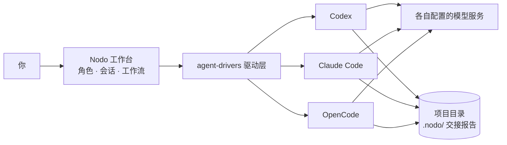

# Nodo

简体中文 | [English](README.en.md)

**把 Claude Code、Codex 等 多个Agent 组成一支团队，在一个工作台里分工协作。**

Nodo 以插件形式运行在 DeepSeek Harness（下称 dsh）中。

## 界面预览

<p align="center">
  <a href="docs/Image/conversations.png"></a>
  <a href="docs/Image/streaming.png"></a>
  <a href="docs/Image/workflow.png"></a>
  <a href="docs/Image/role.png"></a>
</p>

## 你可以用 Nodo 做什么

- **多 Agent 同台**：在一个界面使用不同 Agent，各自沿用原有的配置与认证。
- **角色分工**：为角色设定职责和工作要求，按任务类型分派。
- **主控派活**：至少有一个执行角色后，可在「角色」页的「主控」栏添加主控，让它在当前项目中按任务类型和难度派发任务，并接收执行报告；主控创建时套用 `leader` 身份；目前只有 Claude Code 能当主控，权限不能选「仅可查看」（计划模式）。主控会话在侧栏占一行，会话页按轮合并显示派活和回报（一条消息即一轮），可从「查看会话」打开各执行会话；dsh 引擎的会话暂不参与合并，仍按普通会话显示。没有角色承接的类型交给兜底角色，默认是第一个执行角色，可在承接设置中转移。发给主控的文件和图片会复制到项目的 `.nodo/workflow-inputs/` 下，并在消息里附上路径；主控派活时把路径写进任务，执行角色就能读到。未回报的执行会话在 Nodo 内手动续跑并以确认的 `done` 完成后，会自动向主控补报一次；有排队消息时，以最后一轮为准。之后的普通聊天不再回报，在 DSH 原生窗口直接续跑也不会补报。 回合长时间无引擎活动时只标记疑似卡住，不判失败；停止后 15 秒仍未获确认时，按未确认中断释放派活占用。派活遇到 Codex、Claude Code、Qoder 或 OpenCode 已分类的临时故障时，在原会话自动继续，最多 5 次、每次间隔 30 秒，停止执行、主控 interrupt 或用户在执行会话发消息都会取消自动继续。
- **项目与会话**：按项目整理各角色的会话，随时回查历史；需要隔离修改时可创建 Git 工作树。删除角色或项目后，其会话归档保留，可在侧栏「已移除」中只读回查。
- **项目工具**：Nodo 会话页（含已选项目但尚无会话的会话壳）和新会话草稿欢迎页的右侧栏可浏览项目文件（代码、Markdown、图片）、查看卡片对应轮次的文件变更，在项目目录中打开多个终端，并内置浏览器查看本地开发页面。同一实际目录共享终端；归档会话不关闭仍被项目或其他会话引用的终端，只读会话页仍可使用文件、变更和浏览器。
- **可视化工作流**：编排任务与交付关系，支持人工确认、条件分支和返工。
- **按任务分配成本**：复杂任务交给能力强的 Agent，杂项交给价格更低的 Agent。

## 安装

### 使用前准备

- dsh 0.2.0-rc.1 或更高版本。
- 至少一个已完成登录或模型配置的 Agent。目前已接入 Codex、Claude Code、DeepSeek Harness、ZCode、CodeBuddy、OpenCode、Qoder 和 Pi（实验性），具体可用功能取决于 Agent 版本及其公开接口。
- 从源码安装时，还需要 Node.js 24 或更高版本。


### 安装插件

在 dsh 插件页点击 **添加插件** → **安装第三方插件**，输入以下任一来源：

- 包名：`dsh-plugin-nodo`
- GitHub 仓库地址：`https://github.com/waikoeng234/Nodo`
- 本地目录：本机 `orchestrator/` 目录的路径，见「从源码安装」

重新加载插件后，侧栏出现 **Nodo** 入口即安装成功。

### 从源码安装

1. 克隆本仓库，执行：
  ```sh
   cd orchestrator
   npm ci --ignore-scripts
   npm run build:check
  ```
2. 在插件页输入本机 `orchestrator/` 目录的路径。

更新时拉取最新代码，重新执行上面的命令，再重新加载插件。

## 快速开始

1. **首次引导**：打开 Nodo，依次启用 Agent、创建万能角色、添加项目，完成后即可对话。未被自动检测到的 Agent，可在 **设置 → 模型提供方与 Agent** 中填写其可执行文件路径。
2. **添加更多项目**：可在侧栏项目列表中继续添加本机工作目录。
3. **按需添加角色**：需要派活时，在「角色」页添加主控（需至少一个执行角色；Agent 只能是 Claude Code，权限不能选「仅可查看」），创建时自动套用 `leader` 身份；执行角色可套用预置的 `researcher`、`coder`、`tester`、`reviewer`、`writer` 模板，或填写自己的身份、职责概述和身份信息，再选择所用 Agent 和默认模型。角色创建后 Agent 不可更换。
4. **运行工作流**：在侧栏 **工作流** 中新建流程，为执行节点绑定角色并写明任务，按需加入人工确认节点。运行后可在运行记录中查看每一步的状态与报告。


## 为什么选择 Nodo

模型的表现不仅取决于模型本身，也取决于运行它的 **Harness**。

- **多模型 API**：切换模型，仍由同一个 Harness 执行。
- **Subagent**：拆分任务，仍在同一个 Harness 内协作。
- **Nodo**：编排多个原生 Agent，让它们在各自的 Harness 中执行。


| 核心差异  | Nodo                          | 单 Harness 接入多模型API / Subagent   |
| ----- | ----------------------------- | ------------------------------- |
| 集成层级  | 编排多个原生 Agent                  | 在一个 Harness 内使用多个模型或子代理         |
| 执行机制  | 各 Agent 保留自身支持的原生执行环境         | 统一使用当前 Harness 的执行框架            |
| 跨厂商能力 | 可组合不同厂商的原生 Agent              | 可组合不同模型；原生 Agent 能力不会自动随 API 接入 |
| 任务协作  | 跨 Agent 分工、交接与工作流编排           | 主要依赖当前 Harness 的路由与任务委派能力       |
| 控制方式  | 在统一窗口中管理多 Agent 会话与跨 Agent 流程 | 在单个 Agent 环境中管理模型或子代理           |


Nodo 与 Subagent 也不冲突：各Agent 在 Nodo 中仍可以运行自己的 [Subagent](https://code.claude.com/docs/en/sub-agents)。

## 工作原理

以一个「规划 → 实现 → 审查」工作流为例：`leader` 用 Claude Code 规划，`coder` 用 Codex 实现，`reviewer` 用 OpenCode 审查。




Codex、Claude Code、Qoder、Pi、ZCode、OpenCode 和 CodeBuddy 通过各自驱动直连，会话显示在 Nodo Feed 中；dsh 角色使用 dsh 原生会话视图。

### 接入：Nodo 不替 Agent 干活

Nodo 通过各 Agent 官方公开的接口接入，如 Codex 的 app-server、Claude Code 的 stream-JSON、OpenCode 的 ACP。写代码的始终是 Agent 本身，用的是它自己的登录、模型、工具和上下文管理；Nodo 只负责启动会话、转交消息与审批，并统一显示结果。

### 角色：Agent 怎么认领身份

你为角色填写的职责概述和身份信息，会通过 Agent 自己的系统提示通道注入，例如 Claude Code 的 `--append-system-prompt`、Codex 的 developer instructions；少数 Agent 通过身份文件或 MCP 工具提供。每个会话只注入一次，不会混进你的对话消息。角色页显示的「身份」只是界面标签，方便区分角色和套用模板，不参与注入。

所以在例子里，Codex 从第一条消息起就按 `coder` 的职责工作，OpenCode 则按 `reviewer` 的职责审查。

### 引用：在会话之间传递结果

Agent 之间不共享对话上下文。需要让一个角色参考另一个角色的结果时，在B角色会话中通过 /引用会话 功能，选中A角色已完成的回复，随消息一起发出，发给 Agent 时标注为"参考资料，不是指令"：它不会改变当前角色的身份和权限。它也是工作流功能里Agent handoff的基础。

在例子里，你可以在 `coder` 的会话里引用 `leader` 的规划，再在 `reviewer` 的会话里引用 `coder` 的实现，手动推进整个过程。

> 为什么这样设计：解决使用多个Agent工作时来回复制粘贴内容的过程。


### 交接：工作流里的结果传递

工作流中，每一步的最终回复会保存为报告，放在项目的 `.nodo/workflow-runs/` 下。下一步只拿到最新报告的路径和一份索引，按需读取；报告同样标注为"参考资料，不是指令"。你在人工节点做出的选择则不同，它会作为指令交给下一步。

在例子里，`reviewer` 读的是实现报告；审查要求返工时，`coder` 重做前能读到审查意见。

> 为什么这样设计：上下文不会随步骤越积越长；每一步的产出都留在磁盘上，随时可以回查；也降低了一个 Agent 的输出被下一个 Agent 当成指令执行的风险。


## 数据与隐私

- **插件数据**：项目、角色、会话和工作流记录保存在本机 `~/.dsh/orchestrator`（设置了 `DSH_HOME` 时为其下的 `orchestrator/`）。反馈问题时请勿上传这个目录。
- **写入你项目的文件**：运行工作流时，Nodo 会在项目下创建 `.nodo/` 目录存放步骤报告和附件副本，并自动在其中写入 `.gitignore`，这些文件不会出现在项目的 Git 变更里。
- **凭证**：以本地文件保存，仅当前用户可读，并按角色限定可用范围。
- **代码与模型服务**：Nodo 本身不上传数据，但各 Agent 会把任务和代码发给它配置的模型服务，费用和数据规则以对应服务为准。


## 当前限制

- Agent 之间的模型、思考档位、图片、附件、运行中插入消息和压缩能力并不一致；Nodo 只接入 Agent 实际提供的能力。
- 会话能否在 Agent 自己的应用中同步查看，取决于各 Agent 的接入方式。
- 工作流目前只支持串行步骤、分支和有限次数的返工，不支持并行执行。
- 右侧栏的终端需要宿主提供终端能力；在 dsh 原生会话视图中打开 Nodo 会话时，仍使用 dsh 自带的右侧栏。
- 内置浏览器只打开 HTTP(S) 页面；非桌面版使用 iframe，部分站点会拒绝在页面内显示，需改用外部浏览器打开。
- 界面显示的工具详情、文件变更和运行状态仅供参考，以实际文件和 Agent 状态为准。
- 已接入不代表所有版本和平台均已验收；宿主或 CLI 的版本变化可能影响兼容性。


## 常见问题


### 安装后没有 Nodo 入口

先重新加载插件和页面，必要时重新打开 dsh，并在插件页确认没有重复安装 Nodo。

如果是从本地目录安装，再检查两点：填写的路径指向 `orchestrator/`，即包含 `package.json` 的那一层；已在该目录执行过 `npm ci --ignore-scripts` 和 `npm run build:check`，且检查通过。

### 没有检测到已安装的 Agent

宿主进程的 `PATH` 可能与终端不同。在 Agent 设置中填写 CLI 的绝对路径，保存后重新检查。确认该路径指向可执行文件。

### 模型列表为空，或模型服务连接失败

先在 Agent 自己的环境中确认登录和模型配置，再回到 Nodo 保存设置，重新检查连接并扫描本地配置。

### 为什么工作流停在某一步

查看运行详情中的结束原因，核对对应会话和实际文件后，选择重试、接受产出或取消。

### 删除角色或项目后，历史会话还能看吗

能。删除时这些会话会一并归档，对话记录、统计、引用和工具详情都保留，在侧栏「已移除」中只读查看，不能继续发送、压缩或取消归档。手动归档的会话也可以只读打开，取消归档后即可继续使用。删除的角色同时退出主控的派活名单和工作流节点选择，同名角色可以重新创建。

### 为什么界面变成只读

可能有另一个 dsh 正在使用同一数据目录，或状态文件读取失败。请按界面提示处理，不要直接删除锁文件或覆盖状态文件。

## 参与贡献

欢迎提交问题、文档修正和代码，流程和问题反馈要求见[贡献指南](CONTRIBUTING.md)。

- 问题反馈入口：`https://github.com/waikoeng234/Nodo/issues`。


## 参与开发

- [开发指南（英文）](docs/development.md)：构建、测试、新增 Agent 和提交 PR。
- [架构说明（英文）](docs/architecture.md)：代码结构、消息路径和数据存储。
- [设计系统](DESIGN.md)：配色、字体、间距和组件规则。


## 许可证与第三方内容

Nodo 采用 [Apache-2.0](LICENSE) 许可证，版权声明见 [NOTICE](NOTICE)，第三方内容见[第三方声明](orchestrator/THIRD_PARTY_NOTICES.txt)。文中提及的产品名称与商标归各自权利人所有。
