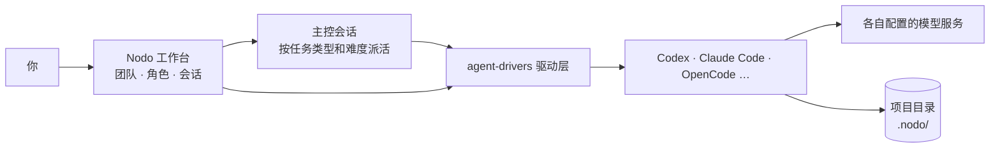

# Nodo

简体中文 | [English](README.en.md)

**把 Codex、Claude Code 等多个 Agent 组成一支团队，在一个工作台里分工协作。**

Nodo 是运行在 DeepSeek Harness（下称 dsh）里的插件。每个 Agent 继续使用自己原生的登录、模型和工具，你在一个窗口里管理角色、派活和会话，不必在多个终端之间来回复制粘贴。

## 你可以用 Nodo 做什么

- **多 Agent 同台**：在一个界面使用不同 Agent，各自沿用原有的登录和模型配置。
- **角色分工**：为角色写清职责概述和身份信息，让它在自己的 Agent 里按这套要求工作。
- **团队**：角色可以加入多个团队，每个团队可设一名主控，并维护自己的任务类型。
- **任务分配**：按团队给每种任务类型指定承接角色，可单独选择模型和思考强度；难题可以另派角色。
- **主控派活**：主控按团队的任务类型和难度派活，执行结果回到主控；派活与回报按轮显示，可随时打开执行会话。
- **项目与会话**：按项目整理各角色的会话；需要隔离修改时创建 Git 工作树；删除角色或项目后，会话归档保留，可只读回查。
- **项目工具**：右侧栏浏览项目文件、查看本轮文件变更、在项目目录中开终端、用内置浏览器打开本地页面。
- **按任务分配成本**：难题交给能力强的 Agent，常规任务交给更便宜的角色和模型。

## 安装

### 使用前准备

- dsh 0.2.0-rc.1 或更高版本。
- 至少一个已完成登录或模型配置的 Agent。目前已接入 Codex、Claude Code、DeepSeek Harness、ZCode、CodeBuddy、OpenCode、Qoder 和 Pi（实验性），具体可用功能取决于 Agent 版本及其公开接口。
- 从源码安装时，还需要 Node.js 24 或更高版本。

### 安装插件

在 dsh 插件页点击 **添加插件** → **安装第三方插件**，输入以下任一来源：

- 包名：`dsh-plugin-nodo`
- GitHub 仓库地址：`https://github.com/waikoeng234/Nodo`
- 本地目录：本机 `orchestrator/` 目录的路径，见「从源码安装」

重新加载插件后，侧栏出现 **Nodo** 入口即安装成功。

### 从源码安装

1. 克隆本仓库，执行：
   ```sh
   cd orchestrator
   npm ci --ignore-scripts
   npm run build:check
   ```
2. 在插件页输入本机 `orchestrator/` 目录的路径。

更新时拉取最新代码，重新执行上面的命令，再重新加载插件。

## 快速开始

1. **首次引导**：打开 Nodo，依次启用 Agent、创建万能角色、添加项目，完成后即可对话。未被自动检测到的 Agent，可在 **设置 → 模型提供方与 Agent** 中填写程序路径。
2. **添加更多项目**：在侧栏项目区继续添加本机工作目录；需要隔离修改时，在项目行的菜单里选择「创建工作树…」。
3. **创建角色**：在「角色」页新建角色，填写名字、职责概述和身份信息，选择 Agent、模型、思考强度和权限。可套用 `researcher`、`coder`、`tester`、`reviewer`、`writer` 等预置模板，也可以自己写。角色的 Agent 创建后不能更换。
4. **建团队、设主控**：在同一个页面的「团队」中新增团队，把执行角色拖进成员区，把要当主控的角色拖进「拖入主控」。主控只能是 Claude Code 或 Codex；一个主控只领导一个团队，也不能同时是团队成员。作为主控的会话不能使用「仅可查看」（计划模式）。
5. **任务分配**：点「任务分配」，为团队添加任务类型（名称和「什么时候派这类任务」），给每种类型选择负责角色；需要区分难度时点「困难任务单独指定」，为难题另选角色。
6. **开始派活**：在左侧「团队」标签下新建会话并选择主控，说明目标和约束。主控按团队的分配派活，执行结果回到主控；一轮里的派活和回报会合并显示，点「查看会话」打开对应的执行会话。

## 为什么选择 Nodo

模型的表现不仅取决于模型本身，也取决于运行它的 **Harness**。

- **多模型 API**：切换模型，仍由同一个 Harness 执行。
- **Subagent**：拆分任务，仍在同一个 Harness 内协作。
- **Nodo**：编排多个原生 Agent，让它们在各自的 Harness 中执行。

| 核心差异 | Nodo | 单 Harness 接入多模型 API / Subagent |
| --- | --- | --- |
| 集成层级 | 编排多个原生 Agent | 在一个 Harness 内使用多个模型或子代理 |
| 执行机制 | 各 Agent 保留自身支持的原生执行环境 | 统一使用当前 Harness 的执行框架 |
| 跨厂商能力 | 可组合不同厂商的原生 Agent | 可组合不同模型；原生 Agent 能力不会自动随 API 接入 |
| 任务协作 | 跨 Agent 分工、主控派活与报告交接 | 主要依赖当前 Harness 的路由与任务委派能力 |
| 控制方式 | 在统一窗口中管理多 Agent 会话与派活 | 在单个 Agent 环境中管理模型或子代理 |

Nodo 与 Subagent 也不冲突：各 Agent 在 Nodo 中仍可以运行自己的 [Subagent](https://code.claude.com/docs/en/sub-agents)。

## 工作原理

以一个「规划 → 实现 → 审查」的协作为例：主控 `leader` 用 Claude Code 规划并派活，`coder` 用 Codex 实现，`reviewer` 用 OpenCode 审查。



Codex、Claude Code、Qoder、Pi、ZCode、OpenCode 和 CodeBuddy 通过各自驱动直连，会话显示在 Nodo Feed 中；dsh 角色使用 dsh 原生会话视图。

### 接入：Nodo 不替 Agent 干活

Nodo 通过各 Agent 官方公开的接口接入，如 Codex 的 app-server、Claude Code 的 stream-JSON、OpenCode 的 ACP。写代码的始终是 Agent 本身，用的是它自己的登录、模型、工具和上下文管理；Nodo 只负责启动会话、转交消息与审批，并统一显示结果。

### 角色：Agent 怎么认领身份

你为角色填写的职责概述和身份信息，会通过 Agent 自己的系统提示通道注入，例如 Claude Code 的 `--append-system-prompt`、Codex 的 developer instructions；少数 Agent 通过身份文件或 MCP 工具提供。每个会话只注入一次，不会混进你的对话消息。角色保存的「身份」记录的是套用的模板名，只用于界面显示和模板匹配，不参与注入。

所以在例子里，Codex 从第一条消息起就按 `coder` 的职责工作，OpenCode 则按 `reviewer` 的职责审查。

### 团队与主控：怎么派活

- **谁是主控**：把角色拖进某个团队的主控栏，它就是这个团队的主控；同一个角色可以在多个团队里当成员，但只能领导一个团队。主控通过 Nodo 提供的工具派活，只能用本团队的任务类型和难度。
- **在哪派活**：只有在左侧「团队」标签下新建的主控会话会派活。在「角色」标签下新建的主控会话是普通的一对一聊天，不派活，可以使用计划模式。
- **派给谁**：每种任务类型在团队的任务分配里指定承接角色。指定了「困难任务」角色的类型，难题派给该角色、其余派给普通角色；没指定的类型由普通角色接全部任务。没有承接角色时，主控会停止派活并说明缺口。
- **一轮一个**：一个主控会话同一时间只执行一个派活。执行结束后报告回到主控，主控再决定下一步；报告送达前不能开始新的派活。
- **续用与重开**：后续任务按团队当前的分配重新路由。难度或执行角色发生变化时新开会话，并在任务里交代已有改动和剩余问题；同一个执行会话最多再续用 2 次。
- **异常处理**：回合长时间没有引擎活动只标记「疑似卡住」，不判失败。停止后 15 秒仍未获确认时，按未确认中断释放派活占用。派活遇到 Codex、Claude Code、Qoder 或 OpenCode 已分类的临时故障时，在原会话自动继续，最多 5 次、每次间隔 30 秒；停止执行、主控中断或在执行会话发消息都会取消自动继续。

### 引用：在会话之间传递结果

Agent 之间不共享对话上下文。需要让一个角色参考另一个角色的结果时，在 B 角色会话中通过「引用会话」功能，选中 A 角色已完成的回复，随消息一起发出；发给 Agent 时标注为参考资料，不是指令，不会改变当前角色的身份和权限。

在例子里，你可以在 `coder` 的会话里引用 `leader` 的规划，再在 `reviewer` 的会话里引用 `coder` 的实现，手动推进整个过程。

> 为什么这样设计：解决使用多个 Agent 工作时来回复制粘贴内容的过程。

### 报告交接：执行结果怎么回到主控

执行会话结束时，最后一条回复会生成一份引用快照，主控收到一条带这份引用的报告消息；引用不可用时改为内联摘录。报告同样标注为参考资料，不是指令，主控需要自己核对产物和证据。

执行会话的中间过程不会进入主控的上下文。要看细节，用「查看会话」打开原始记录；主控需要时也可以用工具查看派活表。

> 为什么这样设计：主控的上下文只保留结论和引用，不会随任务越积越长；每条产出都留在磁盘上，可以随时回查。

## 数据与隐私

- **插件数据**：项目、角色、团队、会话、引用快照和凭证保存在本机 `~/.dsh/orchestrator`（设置了 `DSH_HOME` 时为其下的 `orchestrator/`）。反馈问题时请勿上传这个目录。
- **写入你项目的文件**：创建 Git 工作树时，仓库下会出现 `.nodo/worktrees/`。给主控发送文件和图片时，它们会复制到项目的 `.nodo/` 下，路径写进消息，主控派活时把路径写进任务。Nodo 会自动在 `.nodo/` 里写入 `.gitignore`，这些文件不会出现在项目的 Git 变更里。
- **凭证**：以本地文件保存，仅当前用户可读，并按角色限定可用范围。
- **代码与模型服务**：Nodo 本身不上传数据，但各 Agent 会把任务和代码发给它配置的模型服务，费用和数据规则以对应服务为准。

## 当前限制

- Agent 之间的模型、思考档位、图片、附件、运行中插入消息和压缩能力并不一致；Nodo 只接入 Agent 实际提供的能力。
- 会话能否在 Agent 自己的应用中同步查看，取决于各 Agent 的接入方式。
- 主控目前只能用 Claude Code 或 Codex；dsh 引擎的会话不参与团队页的轮次合并，仍按普通会话显示。
- 主控只能派发团队任务类型里配置好的工作，没配承接角色就派不出去。
- 右侧栏的终端需要宿主提供终端能力；在 dsh 原生会话视图中打开 Nodo 会话时，仍使用 dsh 自带的右侧栏。
- 内置浏览器只打开 HTTP(S) 页面；非桌面版使用 iframe，部分站点会拒绝在页面内显示，需改用外部浏览器打开。
- 界面显示的工具详情、文件变更和运行状态仅供参考，以实际文件和 Agent 状态为准。
- 已接入不代表所有版本和平台均已验收；宿主或 CLI 的版本变化可能影响兼容性。

## 常见问题

### 安装后没有 Nodo 入口

先重新加载插件和页面，必要时重新打开 dsh，并在插件页确认没有重复安装 Nodo。

如果是从本地目录安装，再检查两点：填写的路径指向 `orchestrator/`，即包含 `package.json` 的那一层；已在该目录执行过 `npm ci --ignore-scripts` 和 `npm run build:check`，且检查通过。

### 没有检测到已安装的 Agent

宿主进程的 `PATH` 可能与终端不同。在 Agent 设置中填写 CLI 的绝对路径，保存后重新检查。确认该路径指向可执行文件。

### 模型列表为空，或模型服务连接失败

先在 Agent 自己的环境中确认登录和模型配置，再回到 Nodo 保存设置，重新检查连接并扫描本地配置。

### 主控为什么不派活

按顺序检查：团队是否已设主控；执行角色是否已加入该团队；团队里是否有任务类型；每种类型是否选了承接角色；难题是否单独指定了角色。主控只能派本团队的任务类型，找不到承接角色时它会说明缺口并停下。

### 删除角色或项目后，历史会话还能看吗

能。删除时这些会话会一并归档，对话记录、统计、引用和工具详情都保留，在侧栏「已移除」中只读查看，不能继续发送、压缩或取消归档。手动归档的会话也可以只读打开，取消归档后即可继续使用。删除的角色同时退出所属团队，团队的主控栏也会清空，同名角色可以重新创建。

### 为什么界面变成只读

可能有另一个 dsh 正在使用同一数据目录，或状态文件读取失败。请按界面提示处理，不要直接删除锁文件或覆盖状态文件。

## 参与贡献

欢迎提交问题、文档修正和代码，流程和问题反馈要求见[贡献指南](CONTRIBUTING.md)。

- 问题反馈入口：`https://github.com/waikoeng234/Nodo/issues`。

## 参与开发

- [开发指南（英文）](docs/development.md)：构建、测试、新增 Agent 和提交 PR。
- [架构说明（英文）](docs/architecture.md)：代码结构、消息路径和数据存储。
- [设计系统](DESIGN.md)：配色、字体、间距和组件规则。

## 许可证与第三方内容

Nodo 采用 [Apache-2.0](LICENSE) 许可证，版权声明见 [NOTICE](NOTICE)，第三方内容见[第三方声明](orchestrator/THIRD_PARTY_NOTICES.txt)。文中提及的产品名称与商标归各自权利人所有。
