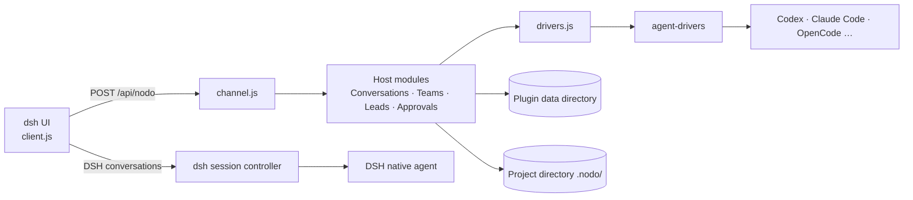

# Architecture guide

This document describes Nodo's code structure and runtime behavior for contributors modifying the source. For a user-facing explanation, see [How it works in the README](../README.en.md#how-it-works). See the [development guide](development.md) for the development workflow.

## Overview

Nodo is a dsh plugin with three parts:

- **Host** (`index.js`, `core/`, `src/host/`): runs in the dsh process, manages projects, roles, teams, conversations, approvals, user decisions, and lead delegation, and starts Agents.
- **Client** (`client.js`, generated from `src/client/`): runs in the dsh web interface and mounts the sidebar, roles and teams pages, conversation panel, lead round view, and right sidebar into host-provided UI slots.
- **Agent adapter layer** (`agent-drivers/`, TypeScript compiled to the committed `dist/`): normalizes public Agent protocols into a common driver interface.



## Directory structure

```text
orchestrator/
  index.js             dsh plugin entry: data home, then core plus the dsh-only modules
  core/                Embedded host package: host modules under src/, plus shared/ used by host and client
  src/host/            dsh-only host modules: native session status, HTTP routes and streams, project terminals, and the loopback MCP endpoint
  src/client/          Sidebar, roles and teams, conversations, settings, and the right sidebar
  agent-drivers/       Agent registration, protocol adapters, and capability interfaces
  scripts/             Build and check scripts, plus manual probes under scripts/manual/
  test/                Automated tests, simulated CLIs, and test helpers
  client.js            Generated browser entry
  cordis.patch.yml     dsh bundle declaration
```

## Host modules

Each runtime module under `core/src/` exports `install(rt)` and attaches its functions to the shared `rt` object. Pure helpers imported by those modules (`dispatch-sinks.js`, `lead-rules.js`, `lead-view.js`, `lead-recovery.js`, `image-types.js`) add no `rt` surface. `MODULES` in `core/src/index.js` loads runtime modules in order: `diag` comes first and provides the shared `rt.warn`; `channel` comes last and exposes interfaces over the other modules. The dsh plugin's own modules (`src/host/native-status.js`, `src/host/route.js`, `src/host/terminal.js`) install after the core modules. Modules do not call each other during installation; they interact through `rt` only at runtime.

| Responsibility | Modules |
| --- | --- |
| State and data | `store` (`state.json` and transcript reads and writes), `home-lock` (single-writer lock), `secrets` (credentials and redaction) |
| Projects and roles | `workspaces` (project directories), `worktrees` (Git worktrees), `profiles` (roles), `sessions` (conversations) |
| Agent bridging | `drivers` (driver process lifecycle), `engine-settings` (Agent settings), `dispatch` (sending, steering, and queuing messages), `approvals` (approval cards) |
| Conversation content | `prompt` (rendering role briefs, references, lead rules and worker input sections), `session-references` (manual conversation references), `attachments` (images, attachments and staged file copies), `stream-records` (tool details), `stats` (conversation statistics), `context` (result, report, evidence, decision, message, tool-record and acceptance reads), `triggers` (pending user originals and persisted references), `compose-worker-input` (record-only worker input), `native-status` (plugin module in `src/host/`) |
| Teams and leads | `teams` (teams, task types, and the per-type assignment table in `prefs.teams`), `tasks` (task and execution records, relations, and acceptances), `lead` (route actions, dispatch, flight budgets, report delivery, and retries), `flow` (the task flow state machine: stage advancement, conditional review, stalls, acceptance, and the per-task cards), `decisions` (user decision records, the dispatch pause, answer handoff and recovery), `lead-channel` (the `nodo_lead` MCP channel exposing only board, context, route and review tools; served from the host's loopback MCP endpoint in `src/host/mcp.js`, with a stdio child process as fallback), `core/shared/route.js` (pure routing decision), `core/shared/lead.js` (which engines may lead) |
| Worker reporting | `worker-channel` (the `nodo_worker` MCP channel for worker sessions: token callers resolve their session's running execution at call time and read only whitelisted handles; same loopback endpoint and stdio/socket fallback as `lead-channel`), `worker-reports` (validation and persistence of `nodo_report` payloads, evidence archiving, report-card text, and the first-line conclusion parse for degraded review) |
| Project tools | `terminal` (plugin module in `src/host/`: terminals over the host subprocess service and the `/api/nodo/terminal` route) |
| Interface | `channel` (answers `POST /api/nodo`), `route` (registers that HTTP route), `live` (pushes updates over `GET /api/nodo/live`) |

## Message paths

**Agent conversations.** Codex, Claude Code, Qoder, Pi, ZCode, OpenCode and CodeBuddy use their own drivers through `drivers.js` and `dispatch.js`. Nodo displays their messages, tool activity and approval cards in its Feed. These roles do not register dsh model providers or Agent presets.

**DSH conversations.** The dsh driver uses the host's public native session controller. Its `driverSessionId` identifies the native conversation, which opens in the host view. Native status and references use that same identifier.

**Engine context handoff.** A conversation keeps its Nodo id while the engine cursor `driverSessionId` can change; tasks, executions, reports and lead credentials are bound only to the Nodo id. When Claude Code or Codex reports that the resumed engine session no longer exists (`errorKind: 'resume-failed'`, recognised from the engine's own diagnostic naming the resumed id), `dispatch.js` clears the cursor, releases the driver, appends a note to the transcript, and resends the same message once into a new engine context that is primed with the saved task context. A second failure ends the turn normally. A lead is told to read `nodo_board` and the `<nodo-status>` snapshot to pick up active delegations.

**Lead attachments.** User files and images have durable references in transcript lines and trigger records. `compose-worker-input.js` retrieves bytes from the attachment store and materializes files inside the actual execution directory. Cached paths from a previous lead round are not dispatch inputs. A missing byte is explicitly marked unavailable.

**Lead delegations.** `lead-channel.js` authenticates each coordinator and exposes exactly `nodo_board`, `nodo_context`, `nodo_route` and `nodo_review` through the host loopback MCP service, with a private stdio/socket fallback. The lead engines run with their built-in execution tools disabled (see Engines below): a lead routes, reviews reports, and asks — it never writes task text (the worker receives the round's user original verbatim as its requirement) or executes work itself, and these four tools are the whole lead surface (no task-write, delegation, interrupt or decision tool exists). `nodo_route` has action-specific schemas and no task-body field, and its scope must quote the round's user original verbatim (`scope.quote`) or give one single-line note of at most 100 UTF-16 units (`scope.note`). `new` chooses the team type, difficulty, optional title and directory, binds a pending user trigger, initializes `task.flow`, and queues an execution. It sends after a successful lead turn and cancels unsent work after a lead error or stop. `attach` merges input before dispatch, steers or queues a running implementation, queues during review, or opens rework when no execution is active; an acceptance card is resolved as a supplement. Stalled and frozen tasks reject attachment, and unconfirmed executions return busy. `stop` validates ownership before stopping selected execution ids or task ids. `ask` uses the existing decision service and session-wide decision pause. New tasks require all delivered reports reviewed; attachment does not use that gate. The active limit is five executions and the round route budget is 24.

**Worker reports, review and flow progression.** A finished execution delivers a report card to the lead: a bounded preview plus `report:` and `evidence:` handles for the recorded report and evidence. Workers report through the `nodo_worker` MCP — `nodo_report` carries outcome, summary, changed files, verification results, issues, and the stage-specific review flags, verdict/findings or numbered answers; a read-only `nodo_context` exposes the execution's own records and whitelisted transcript handles. The report-method section in the worker input is swapped for stage-specific text instructions whenever the driver has not established the mount (`workerMcpMounted`); a review execution then has to start with a single `结论：通过` or `结论：不通过` line, and a degraded review that cannot read such a line stalls. dsh native sessions have no mount and always use this fallback. `nodo_review` takes execution id, disposition, reason and nonempty basis. `continue` clears delivered report blocking without changing the execution status or accepting the task. `investigate` sends 1–5 bounded questions through the same record-only composer to the current executor as an answer execution, keeping the source card awaiting an answer. Continuing the answer also clears the source card. After a review the program advances the flow on its own: it dispatches the task type's independent review when the implementation report calls for one (flagged risks, missing or unpassed verification, missing flags, or rework after a failed review — review and answer stages never re-trigger), reopens rework on a fail verdict, and otherwise opens the acceptance card; the user accepts or returns on that card, and a return reruns rework from the return text without a lead turn. `nodo_board table=cards` lists this coordinator's open acceptance/stall cards, and cards alone keep a `<nodo-status>` snapshot visible. Legacy tasks without a `flow` are frozen: they take no new leader-routed execution, but their delivered reports can still be reviewed.

**Session continuation.** `continues` creates a new task and stores the source in `task.source.continuesTaskId`; it is mutually exclusive with `parentId` and `dependsOn`. The source's latest execution must have ended, including confirmation, and its directory is retained; a conflicting `worktree` is refused. The previous session is reused only while it belongs to this coordinator, is idle and unarchived, has the same role, difficulty and directory, and has fewer than five executions. An independent type cannot reuse a session that ran implementation work. Source results are bounded read-only summaries plus result handles. Execution change summaries retain per-path operations and capture completeness, including the attribution caveat on workspace snapshots; full results remain readable with `nodo_context`.

**Delegation context.** `triggers.js` keeps the current trigger in memory and persists it only when referenced by a successful route. User, task and reconstructed decision-answer inputs bind a trigger at the start of their round; report and retry rounds clear it. Worker input is composed exclusively by `composeWorkerInput({ executionId })` from saved records: the current user original verbatim, supplements, attachments, fixed scope, a note of files other tasks touched since the session's last execution, stage, reviewed execution or questions where relevant, and prior conclusions. Implementation/rework also receive applicable decision and dependency acceptance summaries with handles, archived dependency result paths, and a continuation-source summary. Fresh sessions get the bounded original-user/leader history window; system-generated user rows are excluded. Titles and review reason/basis do not become task instructions. The 96,000-unit budget compresses history first, then prerequisite summaries, then prior-round details; originals and attachment lists never drop. `startExecution` records bounded input metadata. `report:` and `evidence:` context handles enforce coordinator ownership and return unavailable when an old execution has no corresponding record.

**Engines.** Only Claude Code and Codex can lead (`LEAD_ENGINES` in `core/shared/lead.js`). A Claude leader starts with empty `--tools` and `--strict-mcp-config`, allowlists the four `mcp__nodo_lead__*` tool names through `--allowedTools`, mounts only `nodo_lead` via `--mcp-config`, and keeps the user's personal configuration (`CLAUDE.md`, skills, hooks, plugins). A Codex leader runs on its own app-server process instead of the shared daemon: the driver regenerates a model-catalog override (`agent-drivers/src/codex/catalog.ts`, written as `codex-leader-catalog.json`) from the live `codex debug models` output, switching the leader model's entry to direct tool calling with collaboration disabled so `exec` and the collaboration tools never reach the model; every other effective MCP server, including plugin-provided ones, is disabled by name (`mcp_servers.<name>.enabled=false`) after an `mcpServerStatus/list` enumeration, and only `nodo_lead` is mounted. An unreadable or changed catalog entry, a missing leader model, a server name that cannot be addressed as a config key, or a failed enumeration refuses the leader session instead of starting with execution tools reachable; the leader sandbox stays read-only and never requests approval. Codex worker sessions keep the shared daemon and proxy and are unaffected. Worker report mounts by engine: Claude sessions take `nodo_worker` inline through `--mcp-config`; Codex threads mount it in their thread config; ZCode sends `mcpServers` on session create/resume and the ACP drivers (DSH, OpenCode, CodeBuddy) on session new/resume/load, each retrying without it when the peer rejects the unknown field; Qoder inlines `--mcp-config` on its command line; Pi loads a temporary extension that calls `registerMcpServer`. A driver reports `workerMcpMounted` only for a connected session whose supported channel carried the mount; otherwise dispatch sends the text-report fallback.

## Client

`scripts/build-client.mjs` bundles `src/client/` (ESM, plus `core/shared/` data) into `client.js` with esbuild and inlines assets such as icons. dsh loads `client.js` as a plain script. React and UI components are supplied by the host and are not bundled separately.

The client mounts its parts through host UI slots, including run status and references above the composer, conversation message nodes, and tool detail views. UI state such as drafts and navigation is saved in the browser's `localStorage`.

All mounted surfaces share one live data source and one GET NDJSON stream at `/api/nodo/live`. After the initial state and transcript reads, the host combines changes over 100ms and pushes running status, approvals, statistics, session activity and subscribed transcript deltas. Each transcript subscription carries its last position for reconnects; unchanged rows retain their object identity in the client. Structural changes trigger a full state read. Runtime session metadata is persisted without changing the structure version and arrives through the stream. While disconnected, the shared source falls back to incremental polling and retries the stream with exponential backoff from one to 30 seconds. Unmounting the last subscriber aborts the connection and clears its timers; the host releases subscriptions on cancellation or plugin unload.

The sidebar rail switches between the projects tree and the roles page. The tree lists projects only: sessions that run in worktrees group under their owning project, and a single worktree is removed from its parent project's menu. The roles page carries the team editor: a grid of role cards, one column per team with a lead slot and a member column, and a per-team task assignment table. Dragging a card into a lead slot makes it that team's lead; a lead leads one team and belongs to no member list.

In the team view a lead conversation on a non-dsh engine takes one sidebar row: the executor conversations it dispatched are grouped under that row instead of listing separately, and the row's status, time, highlight, role filter and search cover the group. Its page renders the transcript as a round view — the lead's own messages, each dispatch as a chip, and the executor's result preview beneath it — with 查看会话 switching to the executor conversation, 停止 ending a live delegation, and statuses such as 结果未确认, 已取消, 已中断, 未回报, 等待自动继续, and 等待用户. An unfinished decision renders as a card below the round view with the question, each option's cost, the recommendation and its reason, the linked tasks, the executions still running or stopping, and a two-step cancel; the feed renders a submitted answer as its question and chosen option instead of the stored JSON. The merge is driven by record fields rather than text: dispatch notes carry `delegation`, executor conversations carry `source.leadSessionId`, and sessions without them render as ordinary conversations. Executor conversations on the dsh engine are not grouped, and the same conversations list separately in the 角色 view. Long silence only marks a turn as suspected stuck, without failing it; an unconfirmed stop frees that delegation's slot after 15 seconds.

Nodo conversation pages, their legacy shells before a session exists, and `NewConversation` draft welcomes with a selected project own a right sidebar in the host's `rightbar` slot, with tabs for project files, turn changes, terminals, and a browser. Legacy shells keep their existing content and drafts; `NewConversation` binds the Nodo sidebar only for drafts rendered by `NodoEntry`. Read-only conversation pages retain files, changes and the browser but do not restore or operate terminals. File-changes cards open a single replaceable changes tab with a snapshot and an independent `stream-detail` reader, so saved details remain loadable after the card unmounts. The read-only `workspace-dir` and `workspace-file` endpoints accept a workspace or a session target and render files with host primitives. The read-only `task-list` and `task-get` endpoints read the lead task board, scoped by workspace or team where given. Terminal operations accept `{ workspace }` or explicit `{ profile, session }`; the server validates the target and groups terminals by the real working directory, including worktrees, without trusting a client-supplied cwd. A valid session without a working directory lists terminals as unavailable. Output streams as NDJSON from `/api/nodo/terminal`; the browser uses the desktop host's leased webview when available and an iframe otherwise. Open state and tabs live in memory and survive switches within the same directory: after a page refresh terminals are listed again and replayed from their buffers, while file, changes and browser tabs are not restored. Terminals end when their tab closes, when no live workspace or unarchived conversation references their directory, or when the plugin unloads. Native welcomes and Nodo sessions opened in the native conversation view keep dsh's own right sidebar.

## Agent adapter layer

`agent-drivers/` is a separate package embedded in the plugin and can be patched and versioned independently. Each driver implements the same eight primitives: `openSession`, `sendTurn`, `steer`, `interruptTurn`, `respondToRequest`, `onEvent`, `hasSession`, and `dispose`. Agents are registered in `ENGINES` in `agent-drivers/src/index.ts`; the registration metadata also serves client builds and verification scripts.

See the [Agent adapter overview](../orchestrator/agent-drivers/README.md), [driver interface and event protocol](../orchestrator/agent-drivers/PROTOCOL.md), and [Agent intake workflow](../orchestrator/agent-drivers/ENGINE_INTAKE.md).

## Data storage

The plugin data directory defaults to `~/.dsh/orchestrator/`, or the `orchestrator/` subdirectory of `DSH_HOME` when set. It can also be specified through the plugin's `config.home`.

| Location | Contents |
| --- | --- |
| `state.json` | Projects, roles, conversations, `tasks` with their acceptances, `executions` with their input context and archived results, `decisions`, the verbatim user trigger records (`triggers`), the per-task flow cards (`cards`), engine catalogs, and preferences including teams and their task assignments |
| `activity.json` | Transcript lengths and last activity, conversation statistics, and the tool detail ownership index |
| `transcripts/` | One append-only `.jsonl` transcript per conversation; incomplete trailing rows are ignored on read |
| `state.lock` | Write lock: only one dsh can write to the same data directory; other instances are read-only |
| `secrets.json` | Credentials, with mode 600; drivers receive them through `ORCH_SECRET_*` environment variables |
| `attachments/`, `files/` | Pasted images and attachments |
| `references/` | Manual conversation reference snapshots; report snapshots written by older versions remain readable as legacy results |
| `stream-details/` | Tool call details |
| `identities/`, `drivers/`, `agents/` | Role identity files and working directories used by drivers |
| `runtime/` | Private lead and worker channel sockets and their per-session tokens; removed when the plugin unloads |
| `workspaces/` | Working directories created for legacy roles that had none |

State and activity files are written through a temporary file followed by a rename. During a turn, saves are combined at one-second intervals; turn completion and plugin shutdown flush pending writes. Rows of a running turn are written to a per-conversation `.open` journal with each combined save, and append to the JSONL when the turn settles; on load, a journal left by an interrupted host is appended first. History is read on demand, with at most 16 rows and 64KB cached per conversation. Files exceeding 800 rows are compacted on load, or after a write once they reach twice that. An older `.json` transcript migrates on first read and is renamed to `.json.bak`. An unreadable transcript is left unchanged and logged; when its conversation gets new rows, an unreadable `.jsonl` is renamed to `.jsonl.broken-<time>` and a new file starts. `state.json` carries version 6; upgrading a file saved by an older version keeps the original as `state.v<version>.json`, and an older Nodo treats version 6 as newer, neither loads nor overwrites it, and reports that the plugin must be updated. Older embedded transcripts are moved out of `state.json` as they are read. Removing retired state fields or moving the tool detail index keeps `state.retired.json.bak`. The project's `.nodo/` stores Git worktrees, manual and per-task, under `worktrees/`, plus copies of files and images sent to a lead and delegation background material under `workflow-inputs/`, and Nodo automatically writes a `.gitignore` there.

Deleting a role marks it with `deletedAt` and archives its conversations; deleting a project archives the conversations that ran in it and records the original project name in `workspaceName`, and the project's worktree records are removed with it while their directories and branches stay on disk. Every archived conversation keeps its `cwd`, `workspaceRef`, and the role and project names it had. Transcripts, statistics, references, tool details, and identity files remain available. A deleted role leaves every team it was in, a team it led loses its lead, and task routing no longer offers it; it no longer holds a name or a slot under the profile limit, so its name can be reused.

Archived conversations open read-only from the global 已移除 entry; the client requests no task and does not open or select the session on the engine, and the host refuses send, compact, select, update, and unarchive requests for them. Manually archived conversations in existing projects stay in that project's archive filter and also open read-only; unarchiving restores writing while the project still exists. Conversations saved before archival was recorded, with no `archivedAt` and no project, remain writable and are not migrated.

Before a role or project is deleted, the DSH twins of its conversations are archived through the host workspace registry; a failure rolls back the archives that call made and leaves Nodo's records unchanged. Hosts without that interface skip synchronization, and other engines' threads are retained without synchronization. A DSH conversation with no local transcript is read back through the host session inspect call.
