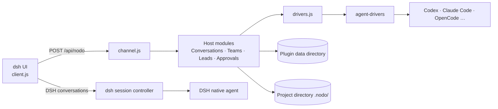

# Architecture guide

This document describes Nodo's code structure and runtime behavior for contributors modifying the source. For a user-facing explanation, see [How it works in the README](../README.en.md#how-it-works). See the [development guide](development.md) for the development workflow.

## Overview

Nodo is a dsh plugin with three parts:

- **Host** (`index.js`, `core/`, `src/host/`): runs in the dsh process, manages projects, roles, teams, conversations, approvals, and lead delegation, and starts Agents.
- **Client** (`client.js`, generated from `src/client/`): runs in the dsh web interface and mounts the sidebar, roles and teams pages, conversation panel, lead round view, and right sidebar into host-provided UI slots.
- **Agent adapter layer** (`agent-drivers/`, TypeScript compiled to the committed `dist/`): normalizes public Agent protocols into a common driver interface.



## Directory structure

```text
orchestrator/
  index.js             dsh plugin entry: data home, then core plus the dsh-only modules
  core/                Embedded host package: host modules under src/, plus shared/ used by host and client
  src/host/            dsh-only host modules: native session status, HTTP routes and streams, project terminals, and the loopback MCP endpoint
  src/client/          Sidebar, roles and teams, conversations, settings, and the right sidebar
  agent-drivers/       Agent registration, protocol adapters, and capability interfaces
  scripts/             Build, check, and verification scripts
  test/                Automated tests, simulated CLIs, and test helpers
  client.js            Generated browser entry
  cordis.patch.yml     dsh bundle declaration
```

## Host modules

Each module under `core/src/` exports `install(rt)` and attaches its functions to the shared `rt` object. `MODULES` in `core/src/index.js` loads modules in order: `diag` comes first and provides the shared `rt.warn`; `channel` comes last and exposes interfaces over the other modules. The dsh plugin's own modules (`src/host/native-status.js`, `src/host/route.js`, `src/host/terminal.js`) install after the core modules. Modules do not call each other during installation; they interact through `rt` only at runtime.

| Responsibility | Modules |
| --- | --- |
| State and data | `store` (`state.json` and transcript reads and writes), `home-lock` (single-writer lock), `secrets` (credentials and redaction) |
| Projects and roles | `workspaces` (project directories), `worktrees` (Git worktrees), `profiles` (roles), `sessions` (conversations) |
| Agent bridging | `drivers` (driver process lifecycle), `engine-settings` (Agent settings), `dispatch` (sending, steering, and queuing messages), `approvals` (approval cards) |
| Conversation content | `prompt` (rendering role briefs, references, and lead rules), `session-references` (conversation references), `attachments` (images and attachments), `stream-records` (tool details), `stats` (conversation statistics), `context`, `native-status` (plugin module in `src/host/`) |
| Teams and leads | `teams` (teams, task types, and the per-type assignment table in `prefs.teams`), `lead` (routing, dispatch, reports, and retries), `lead-channel` (the `nodo_lead` MCP channel; served from the host's loopback MCP endpoint in `src/host/mcp.js`, with a stdio child process as fallback), `core/shared/route.js` (pure routing decision), `core/shared/lead.js` (which engines may lead) |
| Project tools | `terminal` (plugin module in `src/host/`: terminals over the host subprocess service and the `/api/nodo/terminal` route) |
| Interface | `channel` (answers `POST /api/nodo`), `route` (registers that HTTP route), `live` (pushes updates over `GET /api/nodo/live`) |

## Message paths

**Agent conversations.** Codex, Claude Code, Qoder, Pi, ZCode, OpenCode and CodeBuddy use their own drivers through `drivers.js` and `dispatch.js`. Nodo displays their messages, tool activity and approval cards in its Feed. These roles do not register dsh model providers or Agent presets.

**DSH conversations.** The dsh driver uses the host's public native session controller. Its `driverSessionId` identifies the native conversation, which opens in the host view. Native status and references use that same identifier.

**Lead attachments.** Files and images sent to a lead conversation are copied under the project's `.nodo/workflow-inputs/`, and their paths are appended to the message the lead receives. The executor never sees the lead's conversation, so the lead passes those paths in the task.

**Lead delegations.** `lead-channel.js` serves the lead's `nodo_board`, `nodo_delegate`, `nodo_interrupt`, and `nodo_task` tools to Claude Code and Codex over a private socket in `runtime/`, with one token per lead session. `lead.js` validates the requested task type and difficulty against the lead's team, routes it with `core/shared/route.js`, and uses `tasks.js` to persist a Task and one Execution per delegation. Each Execution binds its executor conversation, route, status, short result summary and reference ids; task completion, reopening and title/brief revisions of unfinished tasks are separate decisions through `nodo_task`. New conversation `source` records retain their origin, while old `source.dispatch` records remain readable. Accepted executions stay queued until the lead turn ends normally, then persist running before being sent exclusively through `rt.send`. A lead session keeps up to five executions active at once and accepts at most 24 per turn; the budget resets when the user messages the lead. One turn can dispatch several independent tasks, and reports deliver first in first out without blocking new dispatches. Restart cancels queued executions as unsent and marks running executions unconfirmed. When the executor ends, `lead.js` stores a reference snapshot through `session-references.js`, associates it with the Execution, and queues a report message for the lead; a failure to snapshot falls back to inline text. A stop that the engine does not confirm within 15 seconds is settled as unconfirmed, and transient engine errors that the driver classifies as retryable are continued in the same session up to five times. A delegation with `worktree:true` runs in a task worktree created from the lead workspace's HEAD on a `nodo/task-*` branch: the Execution carries its own workspace reference, the task keeps that directory across executions, worktrees of never-dispatched executions are removed automatically, and Nodo never merges — integration is a manual merge or a separate delegation without isolation.

## Client

`scripts/build-client.mjs` bundles `src/client/` (ESM, plus `core/shared/` data) into `client.js` with esbuild and inlines assets such as icons. dsh loads `client.js` as a plain script. React and UI components are supplied by the host and are not bundled separately.

The client mounts its parts through host UI slots, including run status and references above the composer, conversation message nodes, and tool detail views. UI state such as drafts and navigation is saved in the browser's `localStorage`.

All mounted surfaces share one live data source and one GET NDJSON stream at `/api/nodo/live`. After the initial state and transcript reads, the host combines changes over 100ms and pushes running status, approvals, statistics, session activity and subscribed transcript deltas. Each transcript subscription carries its last position for reconnects; unchanged rows retain their object identity in the client. Structural changes trigger a full state read. Runtime session metadata is persisted without changing the structure version and arrives through the stream. While disconnected, the shared source falls back to incremental polling and retries the stream with exponential backoff from one to 30 seconds. Unmounting the last subscriber aborts the connection and clears its timers; the host releases subscriptions on cancellation or plugin unload.

The sidebar rail switches between the projects tree and the roles page. The tree lists projects only: sessions that run in worktrees group under their owning project, and a single worktree is removed from its parent project's menu. The roles page carries the team editor: a grid of role cards, one column per team with a lead slot and a member column, and a per-team task assignment table. Dragging a card into a lead slot makes it that team's lead; a lead leads one team and belongs to no member list.

In the team view a lead conversation on a non-dsh engine takes one sidebar row: the executor conversations it dispatched are grouped under that row instead of listing separately, and the row's status, time, highlight, role filter and search cover the group. Its page renders the transcript as a round view — the lead's own messages, each dispatch as a chip, and the executor's report beneath it — with 查看会话 switching to the executor conversation, 停止 ending a live delegation, and statuses such as 结果未确认, 已取消, 已中断, 未回报, and 等待自动继续. The merge is driven by record fields rather than text: dispatch notes carry `delegation`, executor conversations carry `source.leadSessionId`, and sessions without them render as ordinary conversations. Executor conversations on the dsh engine are not grouped, and the same conversations list separately in the 角色 view. Long silence only marks a turn as suspected stuck, without failing it; an unconfirmed stop frees that delegation's slot after 15 seconds.

Nodo conversation pages, their legacy shells before a session exists, and `NewConversation` draft welcomes with a selected project own a right sidebar in the host's `rightbar` slot, with tabs for project files, turn changes, terminals, and a browser. Legacy shells keep their existing content and drafts; `NewConversation` binds the Nodo sidebar only for drafts rendered by `NodoEntry`. Read-only conversation pages retain files, changes and the browser but do not restore or operate terminals. File-changes cards open a single replaceable changes tab with a snapshot and an independent `stream-detail` reader, so saved details remain loadable after the card unmounts. The read-only `workspace-dir` and `workspace-file` endpoints accept a workspace or a session target and render files with host primitives. Terminal operations accept `{ workspace }` or explicit `{ profile, session }`; the server validates the target and groups terminals by the real working directory, including worktrees, without trusting a client-supplied cwd. A valid session without a working directory lists terminals as unavailable. Output streams as NDJSON from `/api/nodo/terminal`; the browser uses the desktop host's leased webview when available and an iframe otherwise. Open state and tabs live in memory and survive switches within the same directory: after a page refresh terminals are listed again and replayed from their buffers, while file, changes and browser tabs are not restored. Terminals end when their tab closes, when no live workspace or unarchived conversation references their directory, or when the plugin unloads. Native welcomes and Nodo sessions opened in the native conversation view keep dsh's own right sidebar.

## Agent adapter layer

`agent-drivers/` is a separate package embedded in the plugin and can be patched and versioned independently. Each driver implements the same eight primitives: `openSession`, `sendTurn`, `steer`, `interruptTurn`, `respondToRequest`, `onEvent`, `hasSession`, and `dispose`. Agents are registered in `ENGINES` in `agent-drivers/src/index.ts`; the registration metadata also serves client builds and verification scripts.

See the [Agent adapter overview](../orchestrator/agent-drivers/README.md), [driver interface and event protocol](../orchestrator/agent-drivers/PROTOCOL.md), and [Agent intake workflow](../orchestrator/agent-drivers/ENGINE_INTAKE.md).

## Data storage

The plugin data directory defaults to `~/.dsh/orchestrator/`, or the `orchestrator/` subdirectory of `DSH_HOME` when set. It can also be specified through the plugin's `config.home`.

| Location | Contents |
| --- | --- |
| `state.json` | Projects, roles, conversations, `tasks` and `executions` records, engine catalogs, and preferences including teams and their task assignments |
| `activity.json` | Transcript lengths and last activity, conversation statistics, and the tool detail ownership index |
| `transcripts/` | One append-only `.jsonl` transcript per conversation; incomplete trailing rows are ignored on read |
| `state.lock` | Write lock: only one dsh can write to the same data directory; other instances are read-only |
| `secrets.json` | Credentials, with mode 600; drivers receive them through `ORCH_SECRET_*` environment variables |
| `attachments/`, `files/` | Pasted images and attachments |
| `references/` | Conversation reference snapshots, including reports sent back to a lead |
| `stream-details/` | Tool call details |
| `identities/`, `drivers/`, `agents/` | Role identity files and working directories used by drivers |
| `runtime/` | Private lead channel socket and its per-session tokens; removed when the plugin unloads |
| `workspaces/` | Working directories created for legacy roles that had none |

State and activity files are written through a temporary file followed by a rename. During a turn, saves are combined at one-second intervals; turn completion and plugin shutdown flush pending writes. Rows of a running turn are written to a per-conversation `.open` journal with each combined save, and append to the JSONL when the turn settles; on load, a journal left by an interrupted host is appended first. History is read on demand, with at most 16 rows and 64KB cached per conversation. Files exceeding 800 rows are compacted on load, or after a write once they reach twice that. An older `.json` transcript migrates on first read and is renamed to `.json.bak`. An unreadable transcript is left unchanged and logged; when its conversation gets new rows, an unreadable `.jsonl` is renamed to `.jsonl.broken-<time>` and a new file starts. Older embedded transcripts are moved out of `state.json`, whose original is kept as `state.v1.json` or `state.v2.json`. Removing retired state fields or moving the tool detail index keeps `state.retired.json.bak`. The project's `.nodo/` stores Git worktrees, manual and per-task, under `worktrees/` and copies of files and images sent to a lead under `workflow-inputs/`, and Nodo automatically writes a `.gitignore` there.

Deleting a role marks it with `deletedAt` and archives its conversations; deleting a project archives the conversations that ran in it and records the original project name in `workspaceName`, and the project's worktree records are removed with it while their directories and branches stay on disk. Every archived conversation keeps its `cwd`, `workspaceRef`, and the role and project names it had. Transcripts, statistics, references, tool details, and identity files remain available. A deleted role leaves every team it was in, a team it led loses its lead, and task routing no longer offers it; it no longer holds a name or a slot under the profile limit, so its name can be reused.

Archived conversations open read-only from the global 已移除 entry; the client requests no task and does not open or select the session on the engine, and the host refuses send, compact, select, update, and unarchive requests for them. Manually archived conversations in existing projects stay in that project's archive filter and also open read-only; unarchiving restores writing while the project still exists. Conversations saved before archival was recorded, with no `archivedAt` and no project, remain writable and are not migrated.

Before a role or project is deleted, the DSH twins of its conversations are archived through the host workspace registry; a failure rolls back the archives that call made and leaves Nodo's records unchanged. Hosts without that interface skip synchronization, and other engines' threads are retained without synchronization. A DSH conversation with no local transcript is read back through the host session inspect call.
