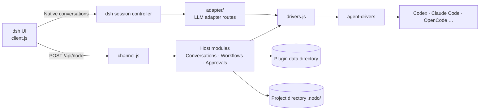

# Architecture guide

This document describes Nodo's code structure and runtime behavior for contributors modifying the source. For a user-facing explanation, see [How it works in the README](../README.en.md#how-it-works). See the [development guide](development.md) for the development workflow.

## Overview

Nodo is a dsh plugin with three parts:

- **Host** (`index.js`, `src/host/`): runs in the dsh process, manages projects, roles, conversations, approvals, and workflows, and starts Agents.
- **Client** (`client.js`, generated from `src/client/`): runs in the dsh web interface and mounts the sidebar, conversation panel, and workflow canvas into host-provided UI slots.
- **Agent adapter layer** (`agent-drivers/`): normalizes public Agent protocols into a common driver interface.



## Directory structure

```text
orchestrator/
  index.js             Host plugin entry and module loading
  src/host/            State storage, conversations, Agent bridging, approvals, and workflows
  src/host/adapter/    Adapter routes connecting Agents to dsh native conversations
  src/client/          Sidebar, conversations, settings, and workflow UI
  src/shared/          Data and utilities shared by host and client
  agent-drivers/       Agent registration, protocol adapters, and capability interfaces
  scripts/             Build, check, and verification scripts
  test/                Automated tests, simulated CLIs, and test helpers
  client.js            Generated browser entry
  cordis.patch.yml     dsh bundle declaration
```

## Host modules

Each module under `src/host/` exports `install(rt)` and attaches its functions to the shared `rt` object. `MODULES` in `index.js` loads modules in order: `diag` comes first and provides the shared `rt.warn`; `channel` comes last and exposes interfaces over the other modules. Modules do not call each other during installation; they interact through `rt` only at runtime.

| Responsibility | Modules |
| --- | --- |
| State and data | `store` (`state.json` reads and writes), `home-lock` (single-writer lock), `runs` (workflow run records), `secrets` (credentials and redaction) |
| Projects and roles | `workspaces` (project directories), `worktrees` (Git worktrees), `profiles` (roles), `sessions` (conversations) |
| Agent bridging | `drivers` (driver process lifecycle), `engine-settings` (Agent settings), `dispatch` (sending, steering, and queuing messages), `approvals` (approval cards) |
| Conversation content | `prompt` (rendering role briefs, references, and handoffs), `session-references` (conversation references), `attachments` (images and attachments), `stream-records` (tool details), `stats` (conversation statistics), `context`, `native-status` |
| Workflows | `workflows` (definitions and execution), `workflow-materials` (writing handoff materials to disk) |
| Interface | `channel` (`POST /api/nodo`, called by the client) |

## Message paths

Agent conversations have two entry paths. Both ultimately create an agent-drivers driver through `drivers.js`.

**Native conversations.** `src/host/adapter/` uses dsh's `llm.registerAdapter` to register each Agent as a model provider, `nodo:<engine>`, and each role as an Agent preset, `nodo:<engine>:<role id>`. When the user sends a message in a dsh native conversation, `pump.js` forwards it unchanged to the driver and returns Agent text and reasoning to the host. Agent tool activity and approval requests appear as the mirror tool `engine_action` and native approval cards; the host does not execute operations on the Agent's behalf. The mapping between native conversations and Agent threads is saved in plugin state, allowing the same thread to be restored after a host restart. dsh itself uses the host's native session controller directly and does not follow this adapter route.

**Workflow steps.** `workflows.js` creates a separate conversation for each execution step and sends its task exclusively through `rt.send`; `dispatch.js` passes it to the role's driver. `workflow-materials.js` writes the previous step's reports and human decisions under the project's `.nodo/`, and `prompt.js` renders them into the next task. Client messages sent through `channel.js` also use `rt.send`.

## Client

`scripts/build-client.mjs` concatenates `src/client/` and `src/shared/` into `client.js` in a fixed order and inlines assets such as icons. dsh loads `client.js` as a plain script. React and UI components are supplied by the host and are not bundled separately.

The client mounts its parts through host UI slots, including run status and references above the composer, conversation message nodes, and tool detail views. UI state such as drafts and navigation is saved in the browser's `localStorage`.

## Agent adapter layer

`agent-drivers/` is a separate package embedded in the plugin and can be patched and versioned independently. Each driver implements the same eight primitives: `openSession`, `sendTurn`, `steer`, `interruptTurn`, `respondToRequest`, `onEvent`, `hasSession`, and `dispose`. Agents are registered in `ENGINES` in `agent-drivers/src/index.js`; the registration metadata also serves host routing, client builds, and verification scripts.

See the [Agent adapter overview](../orchestrator/agent-drivers/README.md), [driver interface and event protocol](../orchestrator/agent-drivers/PROTOCOL.md), and [Agent intake workflow](../orchestrator/agent-drivers/ENGINE_INTAKE.md).

## Data storage

The plugin data directory defaults to `~/.dsh/orchestrator/`, or the `orchestrator/` subdirectory of `DSH_HOME` when set. It can also be specified through the plugin's `config.home`.

| Location | Contents |
| --- | --- |
| `state.json` | Projects, roles, conversation records, workflow definitions, and conversation statistics |
| `state.lock` | Write lock: only one dsh can write to the same data directory; other instances are read-only |
| `secrets.json` | Credentials, with mode 600; drivers receive them through `ORCH_SECRET_*` environment variables |
| `runs/` | One JSON file per workflow run |
| `attachments/`, `files/` | Pasted images and attachments |
| `references/` | Conversation reference snapshots |
| `stream-details/` | Tool call details |
| `identities/`, `drivers/`, `agents/` | Role identity files and working directories used by drivers |

`state.json` and run records are written through temporary files followed by renaming. The project's `.nodo/` stores workflow reports and attachment copies; Nodo automatically writes a `.gitignore` there.
